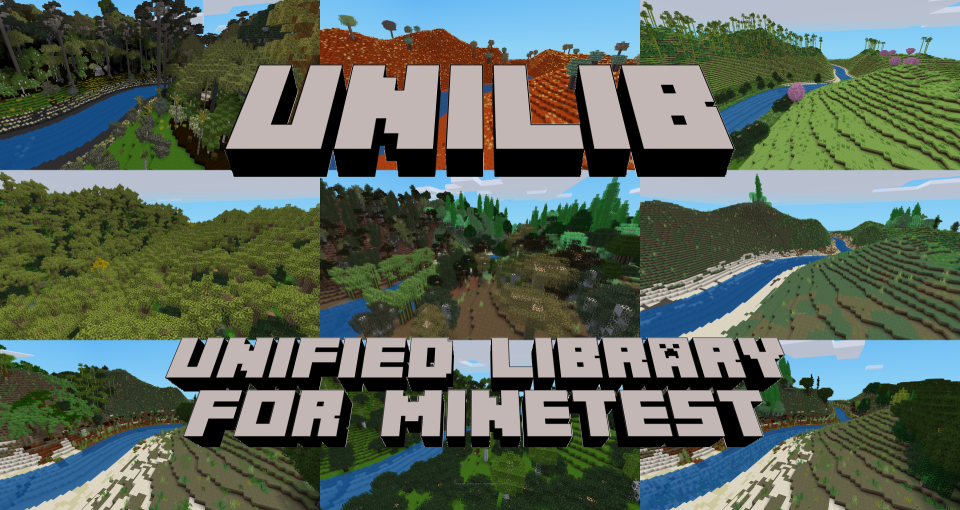

# Unified Voxel Library for Minetest-compatible engines

## Latest release: v1.2.0 (1 Jun 2026) (see recent [changes](CHANGES.txt))

## Want to tinker? Download unilib [here](https://github.com/axcore/unilib)

- **unilib** includes material from over 200 [Minetest](https://www.minetest.net/) mods and modpacks, reorganised as a single mod
- None of this material is loaded automatically - it's up to you to choose what you want
- Many optional features are turned **off** by default

## Want to play? Download unigame [here](https://github.com/axcore/unigame)

- **unigame** is a traditional voxel game with many beautiful biomes and lots of stuff to collect
- It includes [unilib](https://github.com/axcore/unilib), [unimobs](https://github.com/axcore/unimobs), most of the core functions of [minetest_game](https://github.com/minetest/minetest_game), and much, much more besides
- Many optional features are turned **on** by default

## Want more stuff? Add some expansion packs!

- **unilib** expansion packs provide material that are not included in **unilib**, for one reason or another
- The [unimobs](https://github.com/axcore/unimobs) pack provides dozens of creatures (and a few monsters)
- The [unidrinks](https://github.com/axcore/unidrinks) pack (18+) provides various alcholic drinks
- The [unitest](https://github.com/axcore/unitest) pack is an empty template for creating your own expansion packs

## unilib runs with (nearly) everything

- **unilib** is intended for all Minetest-compatible engines, including [Luanti](https://www.luanti.org/)
- **unilib** has no hard dependencies; it will run in any game
- Due to the magic of aliases, **unilib** should be compatible with most mods

## Tips for unilib players

- You can easily create the game of your dreams - no coding skills required!
- Code has been divided into the smallest possible components, called *packages*
    - For example, there is one package for sand, and another providing both stone and cobblestone
- A *remix* is a list of packages
    - **unilib** provides a large selection of remixes, ready for you to use
- When you start playing, **unilib** will ask you to choose the remixes you want
    - To open the configuration window at any time, type **/unilib**
- You can write your own remixes using a simple text editor (see below)
    - To use the in-game system, type **/create_remix** or** /edit_remix**
    - This in-game system can also create new biomes, decorations and ores
    - If [unimobs](https://github.com/axcore/unimobs) is available, it can be used to configure mobs

## Tips for unigame players

- unigame is a traditional voxel game, but some features may be surprising
    - This is a BETA release, so forget about game balance - because there isn't any!
- Your first priority is to find food and water
    - You should build your first house near a water source
    - If you don't enjoy standing in lakes, then wooden buckets are easy to craft
    - With advanced cuisine enabled, you will need to vary your diet
    - Crops and vegetables are more common in forests
    - Not all grasses drop seeds
    - Not all dirts can be used for farming
    - Most fruit trees regrow their fruits, so grab as much as you can!
    - Some kelps can be dried in a furnace, and then used as food
    - Many creatures can be eaten, but watch out for the big, dangerous ones!
- Different stones have different hardnesses
    - You might have to do some exploring before you can craft your first stone tools
    - Pebbles on the surface match the type of stone below the surface
    - A wooden pickaxe can't dig all kinds of stone, and is much slower than other picks
    - Some stones produce rubble, not cobblestone; rubble can't be used to make tools
    - There is lots of collectable stuff in the underground "biomes", which start about 200 metres below the surface
- Torches burn out after a while
    - You should use some kind of lamp to illuminate your house
    - It's easier to see where you're going when you wield a torch
    - Cook tree trunks in a furnace to produce charcoal, from which you can craft torches
- More than one kind of bed is available
    - Wool can be crafted from cotton
    - Cotton seeds are dropped by jungle grass, found only in hot, rainy biomes
- Stairs, carvings and walls exist, but are not visible in your crafting guide
    - Basic stairs and walls have traditional craft recipes
    - Other types of stairs and carvings can be made using machines
- You now share your world with many different creatures
    - Different creatures are tamed, bred, attracted or repelled using various different items
    - Finding out which items to use with which creatures is a part of the game!
    - To get started, try feeding some of the more common animals wheat, or maybe even a carrot or two
    - Most creatures inherit the genetic traits of their parents
    - Over many generations, you can use selective breeding to produce faster, stronger creatures
    - Use a DNA Analyser to measure a creature's genetics
    - Tamed creatures can be named by right-clicking them
    - Some tamed creatures can be given orders
    - Use a bestiary to help you identify unfamiliar creatures
    - It's fun to collect as many animals as you can in a sketchbook
    - Some monsters only spawn at certain times of the (real) year
    - The [unimobs](https://github.com/axcore/unimobs) README describes each creature in detail
- The weather changes frequently
    - Storms and lightning are a little scary, but they're not dangerous
    - Cautious players can craft a weather forecasting console (just like in real life, it's not 100% accurate)
- unilib provides over 700 different achievements
    - Earn achievements for mining diamonds, harvesting crops, or just exploring the world!
    - The more achievements you earn, the higher your level in career paths like **Lumberjack** or **Mountaineer**
    - Reach the highest levels of a career path to obtain a small reward!
- Brand new players should type **/what** in the chat window
- To add new remixes and packages to the game, use **/unilib**, **/create_remix** and **/edit_remix**

## This is a BETA release

- **unilib** is fully playable, but has not been thoroughly play-tested
- **unilib** contains no mobs, little industrialisation and only a few magical items
    - **unigame** includes the **unimobs** expansion pack, providing dozens of creatures
    - **unilib** is compatible with popular mods such as [technic](https://github.com/minetest-mods/technic) and [mesecons](https://github.com/minetest-mods/mesecons)
    - ...but note that **mesecons** must be patched, before use - see the compatibility notes in **../scripts/**
- **unilib** is compatible with all popular inventory mods
    - Some packages interact with [sfinv](https://github.com/luanti-org/minetest_game), [unified_inventory](https://github.com/minetest-mods/unified_inventory) and [inventory_plus](https://github.com/cornernote/minetest-inventory_plus) directly
- **unilib** is highly configurable (see the **Configuring unilib** section)
- Future releases should be compatible with worlds you create now (within reason)
- The most recent release of Minetest/Luanti is recommended

# 1. Remixes and packages

A **unilib** package is a file that contains [Lua code](https://www.lua.org/).

Many packages create items that appear in the world - flowers, trees, tools and so on. Other packages shape the world itself by creating biomes, decorations and ores.

A remix is a list of packages. **unilib** includes over a hundred remixes for you to try.

Many remixes are named after the mods they come from. For example **bonemeal** comes from [the mod with the same name](https://codeberg.org/tenplus1/bonemeal), and includes most of the same material. The **mtgame** remix contains most of the material from [minetest_game](https://github.com/minetest/minetest_game). Most of the time, players won't notice the difference between **unilib** and those original mods. (The imported code has been standardised, so there will always be *a few* changes.)

The most important remix is called **config**. This remix enables **unilib**'s in-game system for selecting, creating and editing remixes. If you don't want to use the in-game system, then a simple text editor or spreadsheet application is just as good. The **config** remix is selected by default; you can unselect it, if you don't need it.

**unilib**'s showcase remix is called **playme**. It is loaded automatically by **unigame** but it also available for users of **unilib**. It provides a great many trees, plants, crops, biomes, stones, metals and minerals. However, it does not provide *all* of those items - that's where you come in! You can create your own customised game by selecting your own remixes, or by creating new ones.

## 1.1 Selecting remixes

The in-game system for selecting, creating and editing remixes can be accessed from the introductory window shown to all new users; otherwise, it requires special privileges.

- Type **/grantme unilib_admin**

You can now select the remixes and packages you want.

- Type **/unilib** to open the configuration window
- Items in the **List of remixes and packages** are loaded every time the game starts
- The **Browse remixes** tab shows all available remixes
    - Click a remix name for more information about it
    - Double-click the remix name to add it to the list
- The **Browse packages** tab gives more information about individual packages
    - If you need a particular package, you can add it to the list
    - By default, any dependencies for this package will be loaded automatically
- When you're ready, click the **Save the list** button
    - The changes are applied when you re-start the game
    - If you have added a lot of biomes, decorations and ores, you should probably start a new world

**unilib** users can choose the remixes they want in the engine's settings. (This is not possible in **unigame**.)

- Click the **Settings** button in the top-right corner
- On the left side, click on **Unified Voxel Library (unilib)**
- On the right side, at the top, find the box **List of remixes and packages to load**
- Type one or more remix names, e.g. **mtgame bonemeal**
- Then click the **Set** button

The **unilib** code can be modified directly, if you prefer.

- In the **unilib** folder (directory), open the file **../lib/system/global/global_override.lua**
- Scroll down to the line containing **unilib.setting.init_remix_pkg_set**
- Beneath it, add the following line, replacing LIST with one or more remix names

        unilib.setting.init_remix_pkg_set = "LIST"

For more information about creating and editing remixes, see the section below.

## 1.2 Replacing original items

**unilib** has been designed to work well with other games, modpacks and mods.

For example, the **mtgame** remix can be used *instead of* [minetest_game](https://github.com/minetest/minetest_game), but it can also be used *in addition* to it! In this case, **unilib** will remove the original flowers, trees and tools, replacing them with its own versions of those items.

The **bonemeal** remix behaves in a different way. If you have also loaded the [bonemeal](https://codeberg.org/tenplus1/bonemeal) mod, its items are *not* replaced. In fact, this is the general rule; by default, only items imported from [minetest_game](https://github.com/minetest/minetest_game) are replaced.

This behaviour can be changed, if necessary. You can edit the **../csv/mods/imported.csv** file to change the behaviour for each original mod. Alternatively, you can tell **unilib** to replace all original items from all other mods (by enabling the setting **Force replacement of items from original mods**).

## 1.3 Updating craft recipes

Popular mods like [mesecons](https://github.com/minetest-mods/mesecons) use ingredients from [minetest_game](https://github.com/minetest/minetest_game) in their craft recipes.

These craft recipes should still work, regardless of whether the original ingredients are availabe, or whether they have been replaced by unilib versions. (Please [report](https://github.com/axcore/unilib/issues) any problems you find.)

## 1.4 World-building remixes

We have already mentioned the **playme** remix, which creates a complete world full of interesting biomes.

The **gaia** and **hades** remixes are the principle components of **playme**. Briefly, **gaia** creates biomes above the surface as well as a large number of ecosystems (a special type of "biome-within-a-biome"). **hades** creates "biomes" beneath the surface, full of useful ores for you to collect.

The **mtgame** remix contains nearly everything from [minetest_game](https://github.com/minetest/minetest_game), including its biomes, decorations and ores. If you don't want those things, you can use the **mtgame_mini** remix, which contains nearly everything *except* the biomes, decorations and ores. Those things are themselves available in their own remixes, **mtgame_biomes**, **mtgame_decos** and **mtgame_ores**. The **default** remix contains nearly everything from [minetest_game](https://github.com/minetest/minetest_game)'s **default** mod.

The following remixes each provide their own collections of biomes, decorations and ores. They should be used together with the **mtgame_mini** remix.

- **ethereal** provides everything from the [ethereal-ng](https://notabug.org/tenplus1/ethereal) mod
- **australia** provides everything from the [australia](https://content.minetest.net/packages/demon_boy/australia/) mod
- **aotearoa** provides everything from the New Zealand-themed mod, [aotearoa](https://content.minetest.net/packages/Eris/aotearoa/)

If you want items from those mods, but without the biomes, decorations and ores, then the remixes **ethereal_mini**, **australia_mini** and **aotearoa_mini** are available.

**unilib** provides a number of remixes corresponding to the mods called (at one time or another) [GAL](https://github.com/ShadMOrdre/GAL_Game). [lib_ecology](https://github.com/ShadMOrdre/lib_ecology) and [lib_materials](https://github.com/ShadMOrdre/lib_materials). These are collectively described as **GLEM**. Again, they should be used together with the **mtgame_remix** (but not with each other).

- **glemr4** is revision 4 (uploaded 12 December 2018)
- **glemr6** is revision 6 (uploaded 19th Apr 2019)
- **glemr11** is revision 11 (uploaded 31st Aug 2019)

## 1.5 Special remixes

There are a couple of special remixes that most players will want to add, at one time or another.

The **standard** remix provides a basic selection of [ABMs and LBMs](https://rubenwardy.com/minetest_modding_book/en/map/timers.html). They are used, for example, to make crops grow and to make turf spread from one dirt node to its neighbours. (**unilib** uses the term "turf" for grass that covers dirt nodes, and "grass" for plants that grow on top of dirt blocks.)

If you have not added the original [minetest_game](https://github.com/minetest/minetest_game) to your world, you should definitely add the **standard** remix.

The **chat** remix provides all of unilib's chat commands. Some of these commands require special privileges (see the section below). The **chat_normal** remix includes only commands that are available to all players.

The **awards** remix provides a large number of awards. Awards are unlocked automatically when the player achieves something. Type **/awards** to see your progress so far.

This **standard** and **awards** remixes are included in **playme**, but the **chat** remixes are not.

## 1.6 Other remixes

Some other useful remixes include:

- **armour** provides not just the [3d_armor](https://github.com/minetest-mods/3d_armor) modpack, but material from a number of related mods
- **atomic** provides a way to convert unwanted items into their raw elemental components. At the moment, the system is somewhat simplistic; it will be probably be expanded in future releases
- **basic_materials** is adapted from the [Basic Materials and Items](https://content.minetest.net/packages/mt-mods/basic_materials/) mod, which provides the raw components used by mods such as [technic](https://github.com/minetest-mods/technic)
- **bonemeal** is from the [bonemeal](https://notabug.org/tenplus1/bonemeal) mod, which should work with all **unilib** trees, plants, grasses, crops, produce and flowers
- **carvings** provides items from three useful mods, [columnia](https://github.com/mt-historical/columnia), [facade](https://github.com/TumeniNodes/facade) and [mymillwork](https://github.com/minetest-mods/mymillwork). Items can carved regardless of whether this remix is loaded (as long as the optional settings have been enabled; see below)
- **empty** is a remix with no packages, used for testing
- **farming_redo** is from the [Farming Redo](https://content.minetest.net/packages/TenPlus1/farming/) mod, which provides a selection of crops and vegetables. Remixes from other farming mods like [cropocalypse](https://content.minetest.net/packages/Tarruvi/cropocalypse/) and [cucina vegana](https://github.com/acmgit/cucina_vegana) are also available
- **highlights** provides a number of items that are unique to unilib
- **minimal** provides the bare minimum number of materials (stone and water) to create a new world
- **misc** provides items from several mods, with each mod contributing only a few packages (not enough to justify creating a new remix for each one)
- **technic** is from the [technic](https://github.com/minetest-mods/technic) modpack, which provides only the raw materials from that modpack. If you want industrialisation in your world, you should load the [technic](https://github.com/minetest-mods/technic) modpack itself
- **towercrane** from the [Tower Crane](https://github.com/minetest-mods/towercrane) mod, which provides a selection of cranes giving you the ability to fly within a small area
- **underch** from the [Underground Challenge](https://gitlab.com/h2mm/underch) mod, providing 62 underground biomes (not the same ones provided by the **hades** remix!)
- **unilib** is a handy list of packages that are original to this mod. It is not really suitable for actual gameplay

## 1.7 Advanced remix selection

As well as remixes, you can specify individual packages to load.

For example, the package called **test_node** creates a node that can't be crafted (but is visible in the player's crafting guide). When added to the list of remixes, it must be preceded by the special character **+**.

In the **List of remixes and packages to load** setting, type the following:

        mtgame bonemeal +test_node

Alternatively, in the **global_override.lua** file described above, change the line to this:

        unilib.setting.init_remix_pkg_set = "mtgame bonemeal +test_node"

You can use another special character, **@**, to clarify that something is a remix, not a package. This is optional, so both **bonemeal** and **@bonemeal** are acceptable. (In the remix list, package names are *always* preceded by the **+** character.)

The final special character, **!**, tells **unilib** *not* to load something. It can be used with both remix and package names:

        !mtgame !@bonemeal !+test_node

**unilib** searches for the **!** character before parsing the rest of the list, so in both of these examples, the package is *not* loaded.

        +test_node !+test_node
        !+test_node +test_node

The **!** character is *always* used before the other special characters, so **@!mtgame** and **+!test_node** will not work.

## 1.8 Pseudo-remixes

There are two "remixes" which are not real remixes at all.

**everything** is a quick way to load **all** remixes (which should load *nearly* all available packages). This does not produce a satisfying game, but it might be useful in the following situations:

- You want to browse the player's crafting guide to see all the items that **unilib** provides
- You want to check for errors and crashes, after modifying **unilib** code (or after writing your own packages)

The word **everything** can be used alone, or it can be added to the remix list, e.g. **mtgame bonemeal everything**.

The second pseudo-remix is **nothing**, which causes *no* remixes or packages to be loaded. If this word is inserted into the remix list, e.g. **mtgame bonemeal everything nothing**, it overrides *everything* else (including the **everything** remix itself!)

**everything** and **nothing** cannot be used with special characters.

Note that the order of remixes is usually not that important, but they are in fact loaded in the order you specify them (unless the list includes **everything** or **nothing**, in which case the order is ignored).

## 1.9 Technical information about remixes

A remix is defined as a folder inside unilib's **../csv/remixes/** folder (and a few other locations). The folder must contain a file called **packages.csv**.

**packages.csv** lists the packages included in the remix. If you want to change the list, you could simply open the file in a text editor. However, any changes you make *might* be overwritten when you update **unilib**. (See below for ways to get around this problem.)

The file lists packages in the following format:

        # Mushroom packages
        mushroom_brown|flowers
        mushroom_red|flowers

Lines that start with the **#** character are ignored. The **|** character is the column separator. Empty lines are ignored, but all other lines must *not* start with whitespace.

**mushroom_brown** and **mushroom_red** are the names of packages. They are followed by the names of the mods they originally come from, but that is optional; you could just as easily list only the package names.

        # Mushroom packages
        mushroom_brown
        mushroom_red

Remixes can *include other remixes*. Do this by placing the character **@** before the remix name.

        # Other remixes to include
        @armour
        @bonemeal
        @castle

(Do not try to add the other special characters such as **+** and **!**; **they only work in the remix list described above**. The pseudo-remixes **everything** and **nothing** cannot be specified here.)

Usually, the order of packages doesn't matter. There are a couple of exceptions; one of which is that "base" packages such as **base_mtgame** and **base_australia** should always be listed first. It also doesn't matter, if the same package is mentioned in several remixes (but you will see a warning, if you list the same package more than once in the same remix).

**unilib's** built-in remixes contain, at the end of the **packages.csv** file, a list of package dependencies. This list is **optional** and **intended only for the convenience of remix writers**; when you start writing your own remixes, there is no need to list all the dependencies. Package dependencies are described in the next section.

Some remixes have names starting with an underline character, e.g. **_decorations_ORIGINAL.csv**. This shows a file that is for reference, not for loading. (This is merely a convention - your packages are free to read any CSV file they like.)

## 1.10 Optional remix files

Every remix folder must contain a **packages.csv** file.

Some remix folders contain other CSV files, which are available for any package to read. The following files are considered "standard", as they interact with **unilib**'s system code:

- biomes.csv
- constants.csv
- decorations.csv
- labels.csv
- ore_blob.csv
- ore_puff.csv
- ore_scatter.csv
- ore_sheet.csv
- ore_stratum.csv
- ore_vein.csv

Most of these files are used to register biomes, decorations and ores, using text rather code.

However, the **labels.csv** file has a different purpose. For example, data in the **gaia** remix is read by several packages (such as **biome_gaia**, **deco_gaia** and so on). Those same packages can read any other compatible remix - for example, the built-in **gaia_simple** remix, or a modified copy of the **gaia** remix you've made yourself.

In this case, the definition of a "compatible" remix is any remix with the label **gaia**. You can label a remix by creating a **labels.csv** file in the remix folder. The file can contain one or more labels, in this case:

        # Mark this remix as being compatible with packages, designed for the "gaia" remix
        gaia

Besides the "standard" CSV files, any remix may contain any number of custom CSV files (see the **atomic** remix for an example). These additional files are ignored until some part of the code (usually a specific package) wants to read them.

## 1.11 Technical information about packages

A package is defined as a **.lua** file inside **unilib**'s **../lib/packages/** folder (and a few other locations). The file is executed as [Lua](https://www.lua.org/) code.

Future releases will include more detailed information about packages, including how to write new ones. For now we'll provide a brief summary.

Packages typically include three [Lua](https://www.lua.org/) functions, **.init()**, **.exec()** and **.post()**.

The **.init()** function is compulsory. It returns a table of data describing the package and its requirements. (On extremely rare occasions it might execute some code of its own.)

The **.exec()** function is optional. It contains the bulk of the code to be executed.

The **.post()** function is also optional. It contains any code that must be executed, *after* every package's **.exec()** function has been called.

For example, the **.exec()** function is used to define both liquids and empty buckets. We don't know how many types of bucket, or how many types of liquid, will exist until every **.exec()** function has been called. Therefore, the code to produce buckets full of liquid is found in the **.post()** function.

Packages can depend on other packages, and even on other mods. Some packages won't run unless some other package (or mod) has already been loaded. Some packages will still run, but will have reduced capabilities.

Information about these dependencies is included in the data returned by the **.init()** function. There are four ways in which a package can depend on other packages:

- **depends** - package A will not run without package B
- **at_least_one** - package A will not run, unless at least one of the packages B, C and D is loaded
- **optional** - package A has some extra functionality, if any of packages B, C and D are loaded
- **suggested** - when craft recipes require a *type* of ingredient instead of a specific ingredient (for example any kind of sugar), then package A will *suggest* a package B which provides that ingredient. Package writers are free to suggest any package providing a suitable ingredient (or even rely on a different mod to provide it)

The same four classes of dependence also apply to other mods; in the table of data returned by the **.init()** function, they are called **mod_depends**, **mod_at_least_one**, **mod_optional** and **mod_suggested**.

Dependencies affect the order in which packages are executed. Specifically:

- The **.init()** function of all packages is called first, in the order specified by the remix
- The **.exec()** function of all packages is called next; the order may be different, because if package A depends on package B, then package B is called first
- The **.post()** function of all packages is called last, in the order specified by the remix

## 1.12 Packages providing biomes, decorations and ores

Packages providing biomes, decorations and ores are named accordingly. Usually the package name includes the name of the original mod (because, for example, more than one mod creates a biome called **grassland**):

        biome_default_grassland
        deco_australia_grass_dry
        ore_ethereal_clay_baked

If you want to write a new remix with its own unique collection of biomes, decorations and ores, then there are a few things to consider.

Firstly, nearly all of these packages will depend on other packages. The biome package in the example above requires all of the following packages:

        dirt_ordinary
        liquid_lava_ordinary
        liquid_lava_ordinary
        sand_ordinary
        stone_ordinary

The decoration package has over a dozen optional dependencies, but just a single hard dependency:

        grass_dry

You can save a bit of time by asking **unilib** to give you a list of all package dependencies that you haven't yet added to your remix. (Enable this behaviour using settings and/or chat commands.)

An interesting feature of **unilib** decorations is that they tend to be split into two parts. This makes it much easier to re-use an existing decoration in a new context.

Let's take the **deco_australia_grass_dry** package for an example. The first half of the decoration's definition is found in the **grass_dry** package itself, and includes the things that don't change: the name of the grass, how densely it occurs, and so on.

The second half is found in the **deco_australia_grass_dry** package, and includes the things that *do* change often: the name of the biome, the height range, and so on.

Because of this feature, it is quite simple to make the grass spawn in other places: just create a new package, modelled on **deco_australia_grass_dry**, but specifying different biomes and/or heights. There is no need to duplicate the first half of the definition (the one found in **grass_dry**); that semi-definition is available for any other package to use.

It's also possible to create biomes, decorations and ores using a spreadsheet (i.e. a **.csv** file). You can see the **gaia** remix for a comprehensive example.

That should give you an idea of what is possible; full instructions about how to create or modify packages, and how to design new biomes, decorations and ores, will appear in a later release.

# 2 Creating and editing remixes

There are several ways to create your own remixes, or to modify existing remixes. You should read the whole of this section before choosing the most suitable method for you.

## 2.1 Remix locations

Remixes are loaded from one of several locations. If you've selected the **mtgame** remix, **unilib** will check the following list from top to bottom, loading the first **mtgame** remix it finds, and ignoring all the others:

- [Minetest](https://minetest.org/)'s own **mod_data** folder
- **unilib** expansion packs, in the order they were loaded
- **unilib** itself, in its **/custom/remixes** folder
- **unilib** itself, in its **/csv/remixes** folder

For security reasons, [Minetest](https://minetest.org/) doesn't allow mods to read and write files anywhere they like. Therefore, the in-game system will *only* modify remixes in [Minetest](https://minetest.org/)'s own **mod_data** folder. (It can also copy remixes from other locations into **mod_data**, and then you can edit the copy.)

Of course, you could use a text editor to modify the files in **unilib**'s own folder. However, the next time you update **unilib**, any changes you make will be lost. The same applies to **unilib**'s "official" expansion packs, when you update them.

All of the methods below will work, but there are only two *recommended* methods:

- Edit remixes in [Minetest](https://minetest.org/)'s own **mod_data** folder
- Create your own expansion pack, and edit remixes there

Regardless of which method you choose, you should be diligent about creating backup copies of your work.

## 2.2 Method 1: Using the in-game system

### 2.2.1 Creating new remixes

To create a new remix, type **/create_remix**, which will open a new window. You can skip this window by typing **/create_remix NAME**, replacing NAME with whatever you want.

A remix consists of a folder containing one compulsory file, **packages.csv**, and several optional ones. If you didn't skip the window, you can use it to create some or all of the optional files automatically.

### 2.2.2 Copying existing remixes

As mentioned above, the in-game system can't modify remixes inside **unilib**'s own folder, but you can make a copy of those remixes in [Minetest](https://minetest.org/)'s own **mod_data** folder, and then edit the copy.

To do this, type **/edit_remix NAME**, where NAME is the name of an existing remix, like **mtgame**.

### 2.2.3 Editing remixes

Once the remix has been created (or copied), you can start editing it.

Type **/edit_remix NAME**, where NAME is the name of your new remix. **unilib** remembers which remix you're editing, so to re-open the editing window, you can just type **/edit_remix** or even **/remix**.

The editing window contains six tabs, each corresponding to a different file inside the remix. Each file is not updated until you click its **Save** button, so do that regularly. (The **Reload** button will cancel any changes you've made since the last save.)

### 2.2.4 The Packages tab

The compulsory **packages.csv** file contains a list of packages to load.

There's a complete list of available packages on the right. You can search for the packages you want, and then double-click to add them to the list.

Alternatively, just type the names of the packages you want: either directly in the box at the top (one package per line), or in the **Package name** box, one at a time.

The **Original mod name(s)** box is intended for developers; you should ignore it. Don't forget that more information about individual packages can be found in the **/unilib** window.

### 2.2.5 The Description tab

The optional **description.txt** file contains a bit more information about this remix (for the benefit of other users). If you choose to add some text here, it will be visible in the **/unilib** window.

### 2.2.6 The Constants tab

The in-game system can create new biomes, decorations and ores.

For example, we might want to create a set of ores that occur at least 100 blocks below the surface. Of course, you could add the value **100** to every ore you create, but what if you change your mind later? Rather than manually updating hundeds of ore distributions, one at a time, we can instead create a **general constant** that only needs to be updated once.

- In the **Constant name** box, type something like **ORE_TOP**
    - Constant names must not contain spaces, so **ORE TOP** is not valid
    - By convention, all constant names are in CAPITAL LETTERS
- In the **Constant value** box, type 100
- Click the **Add** button; the constant appears in the list above
- Click the **Save** button to apply your changes
- Now click on the **Ores** tab
- When you start creating ores here, in the **Max height** box you would add **ORE_TOP** instead of **100**

### 2.2.7 Standard constants

When you start creating your own biomes, decorations and ores using the in-game system, files like **biomes.csv** and **decorations.csv** are created. These files can be quite tricky to modify later, as they contain a confusing mess of characters.

The solution to this problem is to use **standard constants**. These are constants that have **no value** - in other words, they are ignored.

Editing files is much easier when these ignorable values are included. If you want to specify a maximum height, where none was specified before, you can very easily find **NO_MAX_HEIGHT** and replace it with a real value.

Most users should use standard constants:

- In the **Constants** tab, click the **Add biome constants**, **Add decoration constants**, **Add ore constants** buttons
- Click the **Save** button to update the file **constants.csv**
- Now, in the **Biomes** tab, click the button with the same pencil icon
- This will fill most fields with the correct standard constants
- When creating biomes, just replace some of the standard constants with real values
- Do the same thing in the **Decorations** and **Ores** tabs

### 2.2.8 Creating biomes, decorations and ores

The complexities of creating biomes, decorations and ores are beyond the scope of this document. For a more complete description, see the [Minetest](https://minetest.org/) documentation or the various modding guides that are available.

However, it *is* feasible for all users - not just advanced ones - to create simple biomes, decorations and ores that can be used in your games right now. In the sections below we'll create one example of each, ignoring the complexities.

### 2.2.9 The Biomes tab

Every location in the world has a specific heat and humidity, typically a value in the range 0-100. That's why some areas have snow and trees (low heat, high humidity) but others are sandy deserts (high heat, low humidity).

Biomes have **heat points** and **humidity points**. For example, the grassland biome from [minetest_game](https://github.com/minetest/minetest_game) has a heat point of 50 and a humidity point of 35.

Wherever you go in the world, the biome you see is whichever biome is the closest match. For example, if your location has 51 heat and 36 humidity, the biome you see will probably be **default_grassland**. However, even if your location has 30 heat and 70 humidity, you might still see **default_grassland** if the other biomes in the game aren't closer matches.

Now we can create a new biome. All fields are optional, except **Biome name** which is compulsory.

- Enter a unique **Biome name**
    - Enter a description if you like
- Enter the maximum and minimum heights at which this biome is found
    - e.g. maximum **50**, minimum **0**
    - In [Minetest](https://minetest.org/), sea level is at height 1
- Enter the heat and humidity points
    - e.g. for a sandy desert, heat **80**, humidity **20**
    - e.g. for a pine forest, heat **20**, humidity **60**
- The **Dust node** is one which covers the surface, like fallen snow
    - If this is a cold place, you could use **unilib:snow_ordinary**
    - Otherwise ignore this field
- The **Top node** is the node on the surface
    - e.g. Ordinary dirt with turf, which in **unilib** is **unilib:dirt_ordinary_with_turf**
    - This layer is 1 node deep unless you specify a depth, e.g. **unilib:sand_ordinary 3**
- The **Fill node** is just below the surface
    - e.g. Ordinary dirt, which in **unilib** is **unilib:dirt_ordinary**
    - This layer is also 1 node deep unless you specify a depth, e.g. **unilib:dirt_ordinary 5**
- The **Stone node** is everything beneath the **Fill node**
    - If you don't specify it, **unilib:stone_ordinary** is used

When you're ready, click the **Add** button. The new biome should appear in the list at the top; click the **Save** button to update the file itself.

Note that, due to the magic of aliasing, you can (usually) use the original node names from [minetest_game](https://github.com/minetest/minetest_game), i.e. **default:sand** instead of **unilib:sand_ordinary**.

### 2.2.10 The Decorations tab

Decorations are items like grasses and trees which appear throughout the world, whenever it is generated.

[Minetest](https://minetest.org/) provides two types of decoration:

- Single nodes (grasses, flowers)
- Multiple nodes (trees, cacti)

The "plan" for a multiple-node decoration is called a **schematic**. Usually it's one of the files in **unilib**'s **../mts** folder, such as **unilib_tree_apple.mts**, although occasionally packages will create their own schematics on the fly.

**unilib** remixes use four classes of decoration:

- Simple - a single node
- Schematic - multiple nodes
- Schematic (no rotate) - multiple nodes, always placed in the same direction
- Tree log - a single node (a tree trunk) or a schematic (containing mostly tree trunk nodes)

Now we can create a new decoration. All fields are optional, except **Decoration name**.

- In the dropdown box, select **Simple**
- In the **Decoration name** field, type **unilib:grass_jungle**
- Enter the maximum and minimum heights at which this decoration is found
    - e.g. maximum **50**, minimum **0**
    - In [Minetest](https://minetest.org/), sea level is at height 1
- Enter biomes in which this decoration is found
    - e.g. **default_grassland**
- Enter a value in the **Fill ratio** field
    - This value is the number of decorations per surface node
    - e.g. **0.02** for 1 node in every 50

When you're ready, click the **Add** button. The new decoration should appear in the list at the top; click the **Save** button to update the file itself.

If you specify a schematic rather than a **Simple** decoration, then you should specify the name of the file in **unilib**'s **../mts** folder, e.g. **unilib_tree_apple.mts**, not the full file path.

### 2.2.11 The Ores tab

Ores are items that are embedded within other materials, for example iron ores which are found beneath the surface (or inside mountains).

[Minetest](https://minetest.org/) provides six types of ore, each with different characteristics and properties. You can experiment with them and find the one that suits you best. **blob** and **scatter** are good for beginners.

Note that <u>each type of ore has a different file</u>, so before switching from blobs to scatters, you should click the **Save** button to apply your changes.

Now we can create a new ore distribution. All fields are optional, except the **Ore** field.

- In the dropdown box, select **Blob**
- In the **Ore** field, type the name of the ore node
    - e.g. **unilib:stone_ordinary_with_iron**
- In the **Wherein** field, type the name of the stone in which it's found
    - e.g. **unilib:stone_ordinary**
- Enter the maximum and minimum heights at which this ore is found
    - e.g. maximum **-50**, minimum **-200**
    - In [Minetest](https://minetest.org/), sea level is at height 1
- In the **Cl. scarcity** field, specify how rare this ore is
    - Normally we use cubed values, e.g. **125** (which is 5 * 5 * 5)
    - The higher the number, the less common the ore is
- In the **No. ores** field, specify how many iron ore nodes appear in each blob
    - e.g. **3**
- In the **Cl. size** field, specify how far apart the blob's nodes can be
    - e.g. **5**

When you're ready, click the **Add** button. The new ore distribution should appear in the list at the top; click the **Save** button to update the file itself.

## 2.3 Method 2: Create/edit remixes manually

If you don't want to use the in-game creation system, you can just create the remix folder and files yourself, using a text editor or spreadsheet application to edit them.

As described above, there are four distinct locations from which remixes can be loaded.

### 2.3.1 The mod_data folder

This is a recommended location, as it will not be overwritten when you update **unilib**.

- Open [Minetest](https://minetest.org/)'s data folder
- Navigate to **../mod_data/unilib/remixes**
- Inside this folder, create a sub-folder with the name of the remix
    - e.g. **myremix**
- Inside the sub-folder, create an empty file called **packages.csv**

The remix now exists and can be loaded. **unilib** will not complain about the remix being empty, but let's add some packages anyway.

- Open the new **packages.csv** file in a suitable text editor
- Add the following lines, which specify packages adapted from the [bread](https://codeberg.org/Lahusen/bread) mod:

        food_bread_pitta
        food_bread_wholegrain_carrot
        ingredient_dough_pitta
        ingredient_dough_wholegrain_carrot

After adding **myremix** to your remix list (as described above), you can create a new world and start eating!

When you're ready, your new remixes can be copied to any of the other locations. The section above describes the order in which locations are checked; only the first **myremix** found is actually loaded.

### 2.3.2 Create your own expansion pack

Expansion packs are separate mods that provide new remixes and packages. This is a recommended method, as expansion packs are not overwritten when you update **unilib**.

The [unitest](https://github.com/axcore/unilib) expansion pack provides a single test node, but no remixes of its own.  You can use **unitest** as the basis for your own customised expansion pack.

- Open [Minetest](https://minetest.org/)'s data folder
- Navigate to **../mods/**
- [Download](https://github.com/axcore/unilib) **unitest** and copy the files to that location
- Rename the folder from **unitest** to (for example) **mypack**
- Open the folder
- Open the new mod's **mod.conf** file in a text editor
    - Change the mod's name to **mypack**
    - Recommended: In **unilib**'s own **mod.conf** file, add **mypack** as a dependency
- Open the new mod's **init.lua** file in a text editor
    - Replace all three mentions of **unitest** with **mypack**

Now you can continue as above, creating a new remix inside **mypack**'s own **../csv/remixes/** folder.

### 2.3.3 Use unilib's custom folder

**unilib**'s own **../custom/** folder is reserved for your own use. No future release will add any new remixes or packages to this folder, so in principle, it's safe to create new remixes here.

Note that you will **still lose any changes if the whole unilib folder is deleted during an update**. Therefore this is not a recommended method, but it's fine if you can remember to make regular backups.

- Open [Minetest](https://minetest.org/)'s data folder
- Navigate to **../mods/unilib/custom/remixes**

You can now continue as above, creating a new remix inside this folder.

### 2.3.4 Use unilib's standard folder

**unilib**'s built-in remixes are found in its **../csv/remixes** folder. You can, if you really want to, create new remixes here, or edit existing ones.

Note that you will **lose any changes if a remix with the same name is included in a future unilib release**. Therefore this is not a recommended method, but it's fine if you can remember to make regular backups.

- Open [Minetest](https://minetest.org/)'s data folder
- Navigate to **../mods/unilib/csv/remixes**

You can now continue as above, creating a new remix inside this folder.

# 3 Chat commands

**unilib** provides a large number of chat commands. A few of them are used to tweak the player experience, but most are used to assist developers of new remixes and packages.

All **unilib** chat commands are created by packages. For example, the **/list_nodes** command is created by the **chat_list_nodes** package. To load all **unilib** chat commands, add the **chat** remix.

Not all **unilib** chat commands are available to all players. In particular, if you are running a server, you will have to consider which commands should be made available to which players.

In order to have access to *all* of **unilib**'s chat commands, you must grant yourself the following privileges:

        /grantme unilib_tools
        /grantme unilib_admin
        /grantme unilib_danger

The **unilib_tools** privilege enables commands which *might* be suitable for all players on a server, or might *not*. For example, it enables the **/list_trees** command; if you don't want your players to know about every single **unilib** tree in the game, then don't grant them this privilege (or else don't load the **chat_list_trees** package in the first place).

The **unilib_admin** privilege enables commands which are intended for use by server administrators. They might perhaps be appropriate for use in your single-player worlds, too. For example, it enables the **/reset_health** command (which increases a player's health to the maximum.

You should not grant yourself the **unilib_danger** privilege unless you're sure that you need it. It enables the **/cut_trench** command to cut a series of deep trenches into your world, destroying anything in its path.

A complete list of chat commands appears below. This list doesn't mention chat commands provided by **unilib** expansion packs; see their documentation for more details

While playing, you can get a list of commands by opening the engine's chat window and then typing **/help**. (The **packages.csv** file in the **chat** remix also contains a brief summary of each **unilib** chat command and its usage.)

In the lists below, **<ARG\>** represents a compulsory argument, and **[ARG]** represents an optional argument.

## 3.1 unilib configuration

*The following commands require the unilib_admin privilege.*

For more about configuring **unilib** in-game, see the sections below and above.

        /unilib

Opens a window, in which you can configure the list of remixes and packages that's loaded, whenever the game starts.

        /create_remix [remix]

If a **[remix]** name is specified, creates a new remix with that name, also creating default remix files.

Otherwise, opens a window in which you can specify the new remix name and the remix files you want to create.

        /edit_remix <name>
        /remix <name>

Edits an existing remix. **unilib** remembers which remix you're currently editing, so you don't need to specify the **<name\>** more than once.

Also copies an existing (built-in) remix to a new location, from which it can be edited. For more information, see the section above.

## 3.2 Player ALARMS

*The following commands don't require any special privileges.*

        /set_alarm <time>

Sets an alarm which goes off every game day, until cancelled. The alarm is visible in the chat window and is audible (if your volume is not muted). Only you can see and hear your own alarm.

**<time\>** is a 24-hour clock time in the form **HH:MM**, for example **13:30** for half-past one in the afternoon. Quarter-past seven in the morning can be expressed as either **07:15** or **7:15**.

To get the current game time, use the engine's built-in chat command, **/time**.

        /cancel_alarm

Cancels the daily alarm you have set, if any.

        /show_alarm

Shows the daily alarm you have set, if any.

## 3.3 Player AWARDS

*Most of the following commands require the unilib_admin privilege.*

The **awards** remix provides a large number of awards. There are two types of award - **achievements** and **vocations**.

An achievement is unlocked when the player reaches some milestone or other: for example, digging 1000 stone blocks, or harvesting 50 wheat.

Achievements generally count towards vocations; for example digging stone blocks counts towards **Stonecutter**, and harvesting wheat counts towards **Farmer Sam**. Each vocation is made up of several levels; the more achievements you unlock, the higher your level in the vocation. Most vocations provide some kind of reward for reaching the highest levels.

        /awards

Shows your progress in all vocations and achievements. This command does not require any special privileges; the following awards commands do.

        /check_vocations

Checks whether every level in each vocation can be unlocked, by unlocking all of its achievements.

        /show_vocation
        /show_vocations
        /show_achievement
        /show_achievements

Shows a list of vocations or achievements available to players in the game.

        /show_trigger
        /show_triggers

Shows a list of trigger prototypes. A trigger "fires" when the player reaches some milestone or other (such as digging 1000 stone blocks). Trigger prototypes represent a group of similar triggers; for example, **unilib_break** represents many triggers for digging nodes.

        /dump_vocation <pattern>
        /dump_achievement <pattern>
        /dump_trigger <pattern>

Displays detailed information about any vocation/achievement/trigger prototype whose (internal) name or (visible) title matches the specified pattern.

        /dump_player_award [player]

Display details about the specified player's current progress in all vocations and achievements.

        /unlock_vocation <vocation> [player]
        /reset_vocation <vocation> [player]

Unlocks the next level in the specified vocation, or resets the player back to level 0. If a player is not specified, then it's the player who typed the command.

**vocation** is the vocation's internal name, e.g. **unilib_adventurer**.

        /unlock_achievement <achievement> [player]
        /lock_achievement <achievement> [player]

Unlocks or locks the specified achievement. If a player is not specified, then it's the player who typed the command.

**achievement** is the vocation's internal name, e.g. **unilib_mountaineer_comb_1**.

## 3.4 CHECKING things

*The following commands don't require any special privileges.*

Some **unilib** items have craft recipes which require external mods. If those mods aren't loaded, it won't be possible for a player to craft the item.

        /check_ingredients

Checks whether the ingredients provided by external mods are actually available, or not. This command is intended for  people creating new remixes.

## 3.5 Handling craft recipe CONFLICTS

*The following commands require the unilib_tool privilege.*

**unilib** provides thousands of items - not to mention those provided by expansion packs, and indeed by other mods - so when creating new remixes, it's useful to check whether there are any craft recipe conflicts (multiple items which are crafted using the same recipe).

        /count_recipe_conflicts

Checks all nodes, craftitems and tools (even those provided by expansion packs and external mods). Displays the total number of craft recipe conflicts found.

        /check_recipe_conflicts

Checks all nodes, craftitems and tools, displaying detailed output for any craft recipe conflicts found.

        /count_group_conflicts
        /check_group_conflicts

These two commands check craft recipe conflicts, this time taking groups into account. For example, the **fruit_apple** package provides an apple with the **food_apple** group; these commands will check for conflicts in recipes which specify either **unilib:fruit_apple** or **group:food_apple**.

## 3.6 CONVERTING item names

*The following commands require the unilib_tool privilege.*

These commands convert item *names*; they don't convert the items themselves.

        /convert [item]

Shows the **unilib** equivalent of a node, crafitem or tool. **[item]** is the original name of the item in the mod from which it was imported (e.g. **unilib:fruit_apple** is bades on an item originally named **default:apple**).

        /deconvert [item]

This is the same command in reverse, converting the name of a **unilib** **[item]** into the equivalent name in the original mod.

## 3.7 DUMPING data

*The following commands require the unilib_admin privilege.*

These commands "dump" a bunch of information into the chat window.

See also the section below for chat commands that list things. Often you'll need to use a command like **/list_biomes** before a command like **/dump_biome NAME**.

        /dump_node <pattern>
        /dump_craftitem <pattern>
        /dump_tool <pattern>

Dumps the (Lua) definitions of nodes, craftitems or tools.

**<pattern\>** is a regular expression. If your pattern matches more than one item, they are all dumped.

        /dump_item <pattern>

Dumps the (Lua) definitions of all nodes, craftitems and tool matching the **<pattern\>**.

        /dump <name>

The commands just above can dump the definition of many different items all at once, which isn't much fun when you were expecting just a single definition.

For example, if you're trying to see the definition of ordinary stone (**unilib:stone_ordinary)** you'll get many results, because the same **<name\>** also matches nodes like the iron ore, **unilib:stone_ordinary_with_iron**.

This command requires an exact **<name\>**. It will dump either one definition, or none at all.

        /dump_biome <pattern>

Dumps the (Lua) definition of all biomes whose name matches the **<pattern\>**.

        /dump_decoration <pattern>

Dumps the (Lua) definition of all decorations whose name matches the **<pattern\>**.

        /dump_ore <pattern>

Dumps the (Lua) definition of all matching decorations. **<pattern\>** can match an ore type (e.g. **scatter**), the ore node itself (e.g. **unilib:stone_ordinary_with_iron**) or the node in which the ore is found (e.g. **unilib:stone_ordinary**).

        /dump_abm <pattern>
        /dump_lbm <pattern>

Dumps the (Lua) definition of all matching ABMs (Active Block Modifier) or LBMs (Loading Block Modifier). **<pattern\>** matches the ABM label, LBM name or LBM label.

Note that the definition typically consists of mostly Lua code which won't be visible in the dumped text.

        /dump_mods [mod]
        /dump_mod [mod]

Dumps details about all source (original) mods, or just the specified source **[mod]**. These details are loaded from the **../csv/mods/source.csv** file, and its equivalents in any expansion packs.

        /dump_compatible [mod]

Dumps details about all mods which are in the list of **unilib**-compatible mods (and which are not already mentioned in the list of source mods). These details are loaded from the **../csv/mods/compatible.csv** file, and its equivalents in any expansion packs.

Alternatively dumps details about the specified compatible **[mod]**.

        /dump_external [mod]

Dumps details about all mods from which items have been imported, via another mod. For example, **unilib:hardware_chainlink_steel** was imported from the [basic_materials](https://github.com/mt-mods/basic_materials) mod; the same item also exists (under a different name) in the [glooptest](https://github.com/minetest-mods/glooptest) mod.

Alternatively dumps details about the specified external **[mod]**.

These details are loaded from the **../csv/mods/external.csv** file, and its equivalents in any expansion packs.

        /dump_expansion [mod]

Dumps details about all known expansion packs, or just the pack called **[mod]**.

## 3.8 Player EFFECTS

*The following commands don't require any special privileges.*

**Player effects** are features of the player experience. For example, when you dig a block of dirt, does it magically appear in your inventory (as in [Minetest](https://minetest.org/)), or does it drop to the floor (as in [Minecraft](https://www.minecraft.net/))?

Player effects can be enabled or disabled in settings. Assuming that they have been enabled generally, a few effects can be toggled on a per-player basis using chat commands. For example, you can change what happens when you dig a block:

        /toggle_autodrop
        /autodrop

You can also change what happens when you stand near a block that has been dropped on the floor:

        /toggle_autoget
        /autoget

You can see more information about the node directly in front of you. All of the following commands have the same effect:

        /toggle_identify
        /identify
        /what

You can change the size of your hotbar:

        /set_hotbar <size>

**<size\>** should be a value in the range 1 to 32.

        /reset_hotbar

Resets the size of your hotbar back to the size specified by **unilib** settings (8, by default).

Finally, when natural slopes are enabled, you can change the shape of a sloped node at your current position:

        /update_slope

## 3.9 FINDING things

### 3.9.1 Finding biomes

*The following commands require the unilib_admin or unilib_tool privileges.*

        /display_biome

Displays the biome at your character's location. Use this command to toggle the display on and off.

        /show_biome

Displays the biome at your character's location, in the chat window.

        /find_biome [biome]

Attemps to teleport your character to the specified biome. **[biome]** can be the full name of the biome, for example **default_grassland**. It can also be a partial name like **grassland**; **unilib** will teleport you to the closest matching biome. (You can use the **/list_biomes** command to get a list of available biomes.)

This command is useful, but is not a universal panacea. You may find yourself teleported to a location in which the desired biome exists for just a few blocks. Sometimes the specified biome can't be found at all.

**unilib** remembers which biome you are trying to find, so you don't need to type the biome name a second time.

        /switch_biome

Attempts to teleport your character to different biomes in a repeating cycle. You might be able to visit every possible biome just by typing this command repeatedly (subject to the limitations described above).

### 3.9.2 Finding nodes

*The following commands require the unilib_admin privilege.*

These commands are used to find nodes that have spawned in a world, particularly when they are rare.

        /find_nodes <pattern> [width] [height]
        /find_node <pattern> [width] [height]

Finds the closest node matching **<pattern\>**, which is a regular expression. It can be a node name (e.g. **unilib:flower_rose_red**), a partial node name (e.g. **flower**) or a group name (e.g. **group:flower)**.

If **[width]** or **[height]** are specified, the search is restricted to that region.

        /find_all_nodes <pattern> [width] [height]

Finds all nodes matching **<pattern\>** within 100 blocks of your position, or within the surrounding region whose bounds are specified by **[width]** and **[height]**.

        /teleport_to_node

Teleports to the location of the nearest node found by the commands above. This is an blunt-edged command which might teleport you inside solid rock, so use with caution!

## 3.10 HEALTH, stamina, hydration and advanced cuisine

*The following commands require the unilib_admin privilege.*

These commands allow you to tweak the current state of your character. They're intended for package writers who want to test their new code, rather than for players of a cheating mindset.

Stamina, hydration and advanced cuisine are **unilib** effects which must first be enabled in settings.

        /reset_health
        /reset_hunger
        /reset_thirst

Resets your health, hunger or thirst bars.

        /reset_me

Resets your health, hunger *and* thirst bars, using a single command.

        /cripple_health
        /cripple_hunger
        /cripple_thirst

Reduces your health, hunger or thirst bars to a low level (but not so low, that you'll die immediately).

        /cripple_me

Reduces your health, hunger *and* thirst bars, using a single command.

        /clear_food_history

When advanced cuisine is enabled, the player is required to vary their diet. This command clears the list of recently-eaten foods, allowing you to get the normal hunger boost from eating any item.

        /show_food_history

Shows the list of items that your character has recently eaten.

## 3.11 LISTING registered things

### 3.11.1 Listing items

*The following commands require the unilib_tools privilege.*

        /list_nodes [mod]
        /list_node [mod]
        /list_crafitems [mod]
        /list_craftitem [mod]
        /list_tools [mod]
        /list_tool [mod]

Lists all registered nodes, craftitems or tools, or just items from the specified **[mod]**.

Use **!NAME** to list nodes/craftitems/tools from all mods, except the one called NAME.

        /list_items [mod]
        /list_item [mod]

Lists all registered nodes, craftitems and tools, or just items from the specified **[mod]**.

Use **!NAME** to list items from all mods, except the one called NAME.

        /list_hidden

When both **unilib** and one of its source (original) mods are loaded at the same time, **unilib** can hide items from the source mod, so that only the **unilib** equivalents appear in the game. Depending on **unilib** settings, that behaviour may occur, or both items may exist in the world simultaneously.

This commands lists any items which have been hidden.

### 3.11.2 Listing types

*The following commands require the unilib_tools privilege.*

        /list_stones [type]
        /list_stone [type]

All **unilib** stones have a type which matches the name of the package that provides them, for example ordinary stone (from the **stone_ordinary** package) has the type **ordinary**.

Lists all stone types, or displays more details about the specified stone **[type]**.

        /list_trees [type]
        /list_tree [type]

All **unilib** trees have a type which matches the name of the package that provides them, for example apple trees (from the **tree_apple** package) have the type **apple**.

Lists all tree types, or displays more details about the specified tree **[type]**.

        /list_buckets [type]
        /list_bucket [type]

All **unilib** buckets have a type which matches the name of the package that provides them. For example, steel buckets (empty or full) all share the same type, **bucket_steel** (from the **bucket_steel** package).

Lists all bucket types, or lists the buckets (empty and full) matching the specified **[type]**.

        /list_liquids [type]
        /list_liquid [type]

All **unilib** liquids have a type which matches the name of the package that provides them. For example, both the source and flowing variants of ordinary water share the type **water_ordinary** (from the **liquid_water_ordinary** package).

Lists all liquid types, or displays more details about the specified liquid **[type]**.

        /list_metals
        /list_metal

All metals provided by **unilib** have a type which matches the package that provides them. For example, the type **gold** originates from the package **metal_iron**, but matches both the ore (e.g. **unilib:stone_ordinary_with_gold**), the lump obtained by mining it (e.g. **unilib:metal_gold_lump)**, and sometimes other related items.

Lists all metal types.

        /list_metal_sources
        /list_metal_source

Lists all metals and the minerals that provide them. Minerals that provide metals are quite rare, so don't be surprised if this list specifies no sources.

        /list_nonmetals
        /list_nonmetal

Lists all elemental non-metals, such as **carbon** and **nitrogen**. The **elements** remix is a good source of these items.

        /list_nonmetal_sources
        /list_nonmetal_source

Lists all elemental non-metals and the minerals that provide them. Most of **unilib**'s elemental non-metals have no sources; they're intended for package writers who want a complete list of chemical elements.

        /list_minerals
        /list_mineral

All minerals provided by **unilib** have a type which matches the package that provides them. For example, the type **mese** originates from the package **mineral_mese**, but matches both the ore (e.g. **unilib:stone_ordinary_with_mese**), the crystal obtained by mining it (e.g. **unilib:mineral_mese_crystal)**, and sometimes other related items.

        /list_mineral_products
        /list_mineral_product

Lists all metals and elemental non-metals produced by **unilib** minerals.

### 3.11.3 Listing engine things

*The following commands require the unilib_tools privilege.*

        /list_biomes
        /list_biome

Lists all registered biomes.

        /list_decorations [mod]
        /list_decoration [mod]

Lists all registered decorations, or just decorations from the specified **[mod]**.

Use **!NAME** to list decorations from all mods, except the one called NAME.

        /list_ores [matching_text]
        /list_ore [matching_text]

Lists all registered ores, or just ores of the specified ore type (e.g. **stratum**), from the specified mod, or matching the specified node/biome, or at the specified height.

        /list_abms [mod]
        /list_abm [mod]
        /list_lbms [mod]
        /list_lbm [mod]

List all registered ABMs (Active Block Modifiers) or LBMS (Loaded Block Modifiers), or just the ABMs/LBMs from the specified **[mod]**.

Use **!NAME** to list ABMs/LBMs from all mods, except the one called NAME.

        /list_entities [mod]
        /list_entity [mod]

Lists all registered entities, or just entities from the specified **[mod]**.

Use **!NAME** to list entities from all mods, except the one called NAME.

### 3.11.4 Listing unilib things

*The following commands require the unilib_admin or unilib_tool privileges.*

        /list_remixes
        /list_remix

Lists all loaded remixes. The list won't include remixes that are available for use, but not currently loaded.

        /list_remix_labels
        /list_remix_label

Lists all loaded remixes which have remix labels. For more information about remix labels, see the section above.

        /list_packages [package_name]
        /list_package [package_name]

Lists all loaded packages, or details for the specified **[package_name]**. The list won't include packages that are available for use, but not currently loaded.

        /list_other_packages

Lists all packages which are *not* currently loaded, but which are mentioned as dependencies by packages that *are* currently loaded.

        /list_mods [mod]
        /list_mod [mod]

Lists all source (original) mods, or just the specified source **[mod]**. This list is obtained from the **../csv/mods/source.csv** file, and its equivalents in any expansion packs.

        /list_compatible [mod]

Lists all mods which are in the list of **unilib**-compatible mods (and which are not already mentioned in the list of source mods). Alternatively just lists the specified **[mod]**.

This list is obtained from the **../csv/mods/compatible.csv** file, and its equivalents in any expansion packs.

        /list_external [mod]

Lists all mods from which items have been imported, via another mod. For example, **unilib:hardware_chainlink_steel** was imported from the [basic_materials](https://github.com/mt-mods/basic_materials) mod; the same item also exists (under a different name) in the [glooptest](https://github.com/minetest-mods/glooptest) mod.

Alternatively just lists the specified **[mod]**.

This list is obtained from the **../csv/mods/external.csv** file, and its equivalents in any expansion packs.

        /list_expansion [mod]

Lists all all known expansion packs, or just the pack called **[mod]**.

        /list_all

Displays a list that tells you how many of each type of things exists in the game.

## 3.12 MISCELLANEOUS chat commands

### 3.12.1 Teleportation

*The following commands require the unilib_admin privilege.*

        /start1
        /start2
        /start3
        /bay
        /coral
        /dale
        /jungle
        /meadow

These commands were used during **unilib** development. They refer to a specific location in a world generated by the **v7** mapgen with the seed **test**.

Typing any of these commands will teleport you to the named location.

### 3.12.2 Testing

*The following commands require the unilib_admin privilege.*

        /test [param]

This command is provided by the **chat_test** package. You can use it to run some arbitrary code, whnever you need it; just type **/test** as often as necesssary.

You could edit the package to change the code that's executed. By default, it displays a simple "Hello world" message in the chat window.

### 3.12.3 Trenches

*The following commands require the unilib_danger privilege.*

        /cut_trench [width]

Cuts deep trenches in newly-generated terrain, destroying everything in its path.

Trenches are cut at intervals of 100 blocks. If you want, you can specify the trench **[width]**.

Because of its destructive potential, this command requires a special privilege.

## 3.13 Checking craft recipes with MISSING items

*The following commands require the unilib_tools privilege.*

        /count_broken_recipes

Checks for missing ingredients in craft recipes, displaying the total number found. Missing ingredients may occur when an expected package or mod have not been loaded, or by faulty code.

        /check_broken_recipes

Checks for missing ingredients in craft recipes, displaying detailed output.

        /list_groups [group_name]

Displays a list of node/craftitem/tool groups - or the specified **[group_name]** - and the items that provide them.

## 3.14 SHOWING data

### 3.14.1 Attributes

*The following commands require the unilib_admin privilege.*

Attributes are a set of data stored by **unilib**, which are still available for use when the same world restarts. Collectively, they are usually called *mod storage*.

There are two types of attribute: player attributes (unique for each player) and mod attributes (the same for all players).

        /set_mod_attribute <attribute> [value]
        /reset_mod_attribute <attribute>

Sets or resets the **[value]** of a mod **<attribute\>**.

        /show_mod_attributes
        /show_mod_attribute

Shows a table of mod attributes.

        /set_player_attribute <attribute> [value]
        /reset_player_attribute <attribute>

Sets or resets the **[value]** of a player **<attribute\>**.

        /show_player_attributes
        /show_player_attribute

Shows a table of player attributes.

### 3.14.2 Light

*The following commands require the unilib_tools privilege.*

        /display_light

Displays the light level at your character's location. Use this command to toggle the display on and off.

        /show_light

Displays the light level at your character's location, in the chat window.

### 3.14.3 Elements

*The following commands require the unilib_admin privilege.*

The **atomic** remix provides items representing the full list of chemical elements, as well as some equipment to extract samples from various materials. Those packages can be used with the following commands.

        /show_elements [element]
        /show_element [element]

Shows the periodic table. If you specify a chemical **[element]**, only that item is shown.

        /show_rare_elements
        /show_rare_element

Shows chemical elements which are not directly available (by vapourising various materials). This is deliberate; some elemental packages are provided for the benefit of package writers who want a complete Periodic Table available for use.

### 3.14.4 Showing miscellaneous things

*The following commands require the unilib_tools privilege.*

        /show_ingredients <item> [multiple] [list_of_excluded_mods] [list_of_excluded_items]

Displays the full list of ingredients required to craft the specified **<item\>**. Nested craft recipes are supported, so this command is especially useful for hi-tech items which must be crafted in multiple stages.

If **<item\>** doesn't include a mod name, then **unilib** is assumed.

If you specify a **[multiple]** such as 5, then you'll get a list of how many ingredients are required to craft 5 of the **<item\>**.

        /show_inventory
        /inventory
        /inv

Displays your current inventory in the chat window. This command is useful for finding the actual name of a node, craftitem or tool you've found or crafted.

        /show_package <item>

Shows the **unilib** package that provides the specified **<item\>**: a node, craftitem or tool.

## 3.15 Player STATISTICS

### 3.15.1 Player statistics

*The following commands don't require any special privileges.*

**unilib** collects statistics about the player's in-game activities. This system is independent of **unilib**'s awards, which keeps its own records (so you can enable one or the other, or both).

Collection is turned on by default, but can be turned off in settings. There are two collections of data, biographical statistics, and activity statistics; so there are two settings to disable.

To see your statistics, or those of another **[player]**, type this:

        /show_statistics [player]
        /show_stats [player]

You can see more information about how your character has died:

        /show_death

You can also see more about the items you have dug, placed, crafted or eaten:

        /show_dig
        /show_place
        /show_craft
        /show_eat

### 3.15.2 Calender events

*The following commands don't require any special privileges.*

Events are visible in calendars, and describe important events that have taken place in your character's life. For more information about calendars, see the section below.

        /add_event [message]

Adds an event to your personal calendar. Usually you'll specify a **[message]**, e.g. **I found my first diamond**, or **I survived a fight with a bear**, or even **I ate a nice sandwich**.

        /delete_event <game_day>

Deletes events from your personal calendar on the specified **<game_day\>** - e.g. 1 for the first game day, or a value in the form **YYYYMMDD** (according to the in-game calendar).

Only events of the type **default**, such as those created with the **/add_event** command, can be removed with this command.

## 3.16 Changing the TIME

*The following commands require the unilib_admin privilege.*

        /day
        /night
        /dawn
        /dusk

Changes the game time to midday, midnight, dawn or dusk.

        /daylight
        /darkness

Enables permanent daylight or darkness, without changing the game time.

## 3.17 Changing the WEATHER

*The following commands require the unilib_admin privilege.*

        /show_weather
        /show_weathers

Shows a list of available weather effects, and also a list of weather tags (with each tag describing one or more effects).

        /set_weather <weather name> [player]
        /set_weather <weather tag> [player]

Sets the current weather effect for yourself, or for the specified **player**. If you specify a weather tag that applies to more than one effect, an effect is chosen at random.

The new weather effect continues indefinitely, overriding **unilib**'s weather selection system. The weather is reset if you move some distance away, log out, or use the **/reset_weather command**.

        /reset_weather [player]

Resets the current weather effect for yourself, or for the specified **player**. This command cancels the effect set using the **/set_weather** command; it doesn't override **unilib**'s weather selection system for more than a few seconds.

# 4 Configuring unilib

**unilib** is highly configurable. Besides choosing the packages you want, there are a large number of settings which significantly affect the player experience. They can all be configured in the engine's settings menu, as described above.

A full description of **unilib** settings will be added in a future release. In the meantime, here is a selection of the most useful ones.

## 4.1 Cuttings

**Cuttings** are ordinary blocks that have been re-shaped, sometimes in the player's own crafting grid, but sometimes by using a special machine.

There are three types of cuttings. **stairs** have blocky shapes and **carvings** have more refined shapes. **walls** tend to have a single shape that most players will recognise.

Several [Minetest mods](https://content.luanti.org/) provide stairs (for example [stairs_redo](https://notabug.org/tenplus1/stairs), [stairsplus](https://github.com/CasimirKaPazi/stairsplus), [moreblocks](https://github.com/minetest-mods/moreblocks/), [plantlife](https://github.com/mt-mods/plantlife_modpack), [castle](https://github.com/minetest-mods/castle/), [pkarcs](https://github.com/TumeniNodes/pkarcs|)), and other mods provide carvings (for example [columnia](https://github.com/Glunggi/columnia), [facade](https://github.com/TumeniNodes/facade), [mymillwork](https://github.com/minetest-mods/mymillwork)).

All of those mods have been imported into **unilib**. The good news is that they're available for use with a greater variety of blocks than the original mods allowed. The bad news is that the total number of stairs and carvings **greatly exceeds** the [Minetest](https://www.minetest.org/) limit (about 32000 unique items), so you will have to pick and choose which stairs and carvings you want in your world.

By default, only a basic set of stairs and carvings are available. Change the engine's settings to enable additional sets, for example:

        Enable stairs from moreblocks
        Enable facade carvings

By default, *no* stairs and carvings are visible in the player's crafting guide. Change the engine's settings to make them visible, for example:

        Show basic stairs in creative inventory
        Show facade carvings in creative inventory

The crafting recipes for the most basic stairs will be familiar to most players, but in case you don't want to carry a hundred different recipes around in your head, there is a shortcut: use one of **unilib**'s cutting machines.

For example, the circular saw (provided by the package **machine_saw_circular**, in the remix **moreblocks**) comes in four versions. The Mark I machine creates basic stairs, the Mark II machine creates stairs from the **stairs_redo** mod, and so on.

The carving machine (provided by the package **machine_carving**, in the remix **carvings**) provides carvings from the **facade** mod, and the millwork machine (provided by the package **machine_milling**, in the remix **carvings**) provides carvings from the **mymillwork** mod.

## 4.2 Super stones and super trees

Stone and tree nodes (including trunks and branches) can be used to craft a variety of items. Because **unilib** provides such a great variety of stones and trees, there is again a risk of breaching [Minetest](https://www.minetest.org/)'s ~32000 item limit.

A workaround for this problem is to specify a list of **super stones** and **super trees**.

**unilib** will create lots of items crafted from super stones and super trees, but fewer items crafted from normal stones and trees. To take an obvious example, only basic stairs can typically be crafted from normal stone and tree nodes, but the full range of stairs can be crafted from super stone and super tree nodes.

Many other items, besides just stairs and carvings, are available (or not) depending on which stones and trees you have designated as "super" stones and trees.

By default, the range of super trees are those derived from [minetest_game](https://github.com/minetest/minetest_game): the apple (default) tree, aspen tree, pine tree, jungle tree and acacia tree. The super stones are also from [minetest_game](https://github.com/minetest/minetest_game): the default grey stone (called "ordinary" stone in **unilib**), and desert stone.

You can designate any number of stones and trees as "super" stones and trees. A good approach is just to designate one or two things at a time, as you need them. For example, in settings you could change **Super tree types can craft anything** to this:

        acacia aspen apple jungle pine banana orange healing frost redwood

...which will designate a selection of trees derived from [ethereal-ng](https://codeberg.org/tenplus1/ethereal).

As with remixes, the words **everything** and **nothing** can be specified, though if you specify **everything** you may be disappointed when [Minetest](https://www.minetest.org/) informs you that you've reached the item limit. **everything** overrides any tree types in the list, and **nothing** overrides everything else, include **everything** itself.

## 4.3 Super dirts

There is a third category of "super" items, **super dirts**. They behave exactly like super trees and super stones: more items can be crafted from them, and the list of super dirts can include the words **everything** or **nothing**.

The **gaia** and **playme** remixes use a number of different dirts, but that isn't generally the case for other remixes. For that reason, it's usually not worth adding more dirts to your super dirt list.

(By the way, **unigame** players already have an expanded list of super dirts.)

## 4.4 Other dirt settings

Speaking of dirts, you can change the appearance of (most) dirts, so that only turf is visible on the sides of dirt blocks.

To change the appearance of dirt, change the following setting:

        Only turf visible on sides of dirt-with-turf nodes

Some remixes (**gaia** and **playme**, especially) create many hundreds of dirt-with-turf nodes. If you don't particularly want to see them all in your crafting guide, change the following setting:

        Show covered dirt in creative inventory

## 4.5 Squeezed items

All players eventually experience storage problems: how do you store a million cobbleblocks, if your charming rustic house is hardly big enough to swing a cat?

**unilib** allows you to "squeeze" many common items. For example, nine stone blocks can be squeezed to create a single compressed block; nine compressed blocks can be squeezed to create a single condensed block.

Various types of items can squeezed: stone, gravel, dirt, sand, metal and leaves. Each type has its own setting. For example, to allow squeezed leaves block, change the following setting:

        Leaves can be compacted

If you want a maximum of 999 squeezed blocks in each stack, rather than usual maximum of 99, change the following setting:

        Compressed/compacted/condensed blocks have stacks of 999

Squeezed items are normally created in the player's crafting grid. If the [technic](https://github.com/minetest-mods/technic) modpack is loaded, technic machines must be used instead.

## 4.6 Dyes

If you have an exaggerated need for dyes, you can obtain them from crops and fruit (as well from flowers, as normal).

This behaviour is unrealistic, so is disabled by default. To enable it, change the following settings:

        Craft dyes from crops
        Craft dyes from fruit
        Craft dyes from produce

By the way, in **unilib** terminology, **produce** is a crop that can be grown without seeds (usually by planting the harvested item itself, such as a salad tomato).

## 4.7 Individual mod settings

A number of **unilib** settings affect only items from one original mod. There are too many to list here, so we just mention of few of them.

Much of the material imported from [minetest_game](https://github.com/minetest/minetest_game) has been tweaked quite a lot; you can disable many of those tweaks by changing the following setting:

        Allow tweaks to code adapted from minetest_game

If the [advanced trains](https://git.bananach.space/advtrains.git) (advtrains) mod has been loaded, **unilib** will create train platforms out of many different stone types. To disable that behaviour, change the following setting:

        Create advtrains platforms from unilib stones

By default, suitable flowers can be planted in flowerpots. If you want to plant other living things in flowerpots, change the follow settings:

        Add all suitable mushrooms to compatible flowerpots
        Add all suitable plants to compatible flowerpots
        Add all suitable saplings to compatible flowerpots

**unilib** torches burn out after a while. You can set how long an ordinary torch will last (in seconds) by changing the following settings:

        Minimum burn time for ordinary torches
        Maximum burn time for ordinary torches

## 4.8 Tool settings

The [toolranks](https://github.com/lisacvuk/minetest-toolranks) mod, which has been imported into **unilib**, improves the performance of your tools, the more you use them. To enable this behaviour, change the following setting:

        Enable toolranks

Damaged tools can be repaired with a hammer and an anvil. Most anvil mods allow a tool to be repaired limitless times; **unilib** implements a more realistic system, in which a tool eventually wears out completely. To enable it, increase the value of the following setting:

        Limit tool repair over time

Use a value of 0.1 to make a tool repairable 100 times, or a value of 0.01 to make it repairable 1000 times.

## 4.8 Wielded light settings

When your character is walking around the world, you can use an item like a torch or a lamp to light the way. To enable this behaviour, change the following setting:

        Bright items illuminate player's surroundings

## 4.9 Auto-get and auto-drop

As described above, you enable [Minecraft](https://www.minecraft.net/)-style handling of dropped items by changing the following settings:

        Pick up nearby items automatically
        Drop items automatically on dig

## 4.10 Hunger and thirst

By default, simple hunger is enabled, but thirst (hydration) is not enabled.

You can enable advanced cuisine, which rewards players who have a varied diet. (This is not a realistic system; a chocolate cake counts as something completely different to a banana cake.)

You can also enable thirst, if you want it. Assuming that the **thirst** remix has been added, then specialist items will be available in your crafting guide; you can use them if you prefer to drink like a civilised human being, rather than from a hole in the ground.

Change the following settings:

        Advanced eating/drinking
        Enable hydration/thirst

# 5 Notable features

There are over 100 different remixes, and well over 4000 packages. Here are some suggestions for things worth adding to your game.

Many of these suggestions are unique to **unilib**. Most of them have already been added to the **playme** and **highlights** remixes and, of course, you can test any of them by adding the **everything** remix.

## 5.1 Calendars

(Packages **misc_calendar_simple** and **misc_calendar_fancy**, in the **unilib** remix)

(Packages **chat_add_event** and **chat_delete_event**, in the **chat** remix)

**unilib** keeps track of the passage of time. If you craft a simple calendar and then right-click it, the date will be visible. Right-clicking a fancy calendar opens it up for your inspection.

If your character has had an eventful life, some of those events will be visible in the calendar; you can add more using the **/add_event** command.

        /event Today I ate some chocolate cake.

The **/delete_event** command will remove the same event, but it can't be used to remove evidence of your birthdays, your deaths and so on.

The calendar starts on 1st January in the year 1000. This date can be changed in settings. If you're willing to get your hands dirty with some [Lua](https://www.lua.org/) code, then the calendar format is customisable (by creating your own weekdays and months, and by specifying weeks, months and years of any length).

## 5.2 Flags

(**offend_flags** remix)

There's nothing like a nice flag to mark the territory you've claimed as your own. Other Minetest mods provide flags, but only **unilib** provides a convenient flag-printing machine so you don't have to click-click-click to find the flag you want.

To use the machine you'll need some red, green and blue cartridges, as well as some blank flags.

New flags can be added to **unilib** quite easily. First, copy the image files into **unilib**'s **/textures** folder. Then, open the **../csv/remixes/offend_flags/flags.csv** file in a suitable text editor.

In that file, add one new line for every new flag. For example, to add the flag of Japan you would add this line:

        japan||Japan

There are actually three columns: on the left, the flag's "name" and on the right, a description. The middle column is usually left blank; there is no need to specify the texture's filename if it's the same as the flag name.

## 5.3 Distance and surveyor's meters

(Several packages in the **misc** remix)

These laser meters are used to measure distances; they're especially useful for large building projects. Six meters, of varying maximum lengths, are available.

Distance meters are simple. Place a block at one end of the distance you want to measure; at the other end, place the meter and right-click to turn it on. Let your mouse hover over the meter in order to see the distance between it and the placed block.

Surveyor's meters are a little more complex. Place one on the ground, and then right-click it to open a form. Using the form you can turn the meter on or off, or set the mid point and section markers.

## 5.4 Node replacers

(Packages **item_replacer_normal** and **item_replacer_artisanal**, in the **misc** remix)

**unilib** offers two node replacement tools. The "normal" replacer (from the [replacer](https://github.com/Sokomine/replacer) mod) will already be familiar to many users. When used to punch a block, that block is replaced with a single type of thing (until the player runs out, or until the replacer is reset).

The "artisanal" replacer, on the other hand, replaces punched blocks with a selection of different things, choosing one at random each time. It's often used to create realistic-looking paths and walls.

To set up the artisanal replacer, wield it and then right-click.

Drag one or more nodes from your inventory into the grid at the top of the form. This grid represents the probability of each type of thing being placed. If you drag one smooth stone and one cobblestone into the grid, they each have an equal chance of being placed, every time the tool is used. If you drag three smooth stones and only one cobblestone into the grid, then there's only a 25% chance that the cobblestone will be placed each time.

When the form is open, you can switch between placing a node next to the one you've clicked, or else replacing the node you've clicked. (This is a bit different to the "normal" tool, which uses left- and right-clicks respectively for those purposes.)

## 5.5 Castle shields

(Packages **misc_shield_mounted_basic**, **misc_shield_mounted_british** and **misc_shield_mounted_extra**, in the **castle** remix)

The [castle shields](https://github.com/minetest-mods/castle_shields) mod provides three decorative shields to be hung on your castle walls. **unilib** provides a much larger selection.

The **misc_shield_mounted_british** package provides shields with various traditional British themes, and the **misc_shield_mounted_extra** package provides a complete set of shields in various designs and colours.

## 5.6 Paintings and portraits

(Packages **misc_painting_small**, **misc_painting_portrait** and **misc_painting_landscape** in the xdecor remix)

**unilib** provides a selection of famous paintings and portraits, about sixty of them in total.

If you search for "painting" in your crafting guide, you'll find just three items marked S, L and P. When placed in the world, they will transform into a random (S)mall painting, (L)arge painting or (P)ortrait. If you don't like what you see, just place the item again to get a different image.

The resolution of the paintings has been drastically reduced so that the images are a reasonable size. This should fit well with **unilib**'s blocky aesthetic; if you find that you want more realistic images, then you are free to replace the blocky images in the **../textures/** folder with high-resolution alternatives.

## 5.7 Chests

(Packages **container_chest_compact** and **container_chest_bottomless**, in the **misc** remix)

As an alternative solution to the storage problems mentioned above, **unilib** provides a "bottomless" chest. Its size is initially limited to 60 stacks, but you can click the buttons to add extra "pages", each one providing room for another 60 stacks.

At the other end of the scale is **unilib**'s own "compact" chest which has a capacity of just 6 stacks. This might useful in some kind of quest scenario, in which the player's ability to store things needs to be restricted. (If you're willing to tweak the package code, you can change the capacity of the compact chest.)

## 5.8 Atomic machines

(**atomic** remix)

**unilib** provides a way to convert unwanted items into their raw elemental components. At the moment, the system is somewhat simplistic; it will be probably be expanded in future releases.

You can start by placing items into the **vapouriser**. This machine should be connected to a **collector** using **atomic tubes**, placed in a straight line.

The output is randomised; you should get different results every time you place a node in the vapouriser. However, these fluctuations will average out over time. The ideal tube length is 20; any shorter (or longer!) than that will result in reduced output.

The output produced for every input item is specified by files in the **../csv/remixes/atomic/** folder. You can tweak them to satisfy your own requirements, if necessary.

**unilib** packages exist for every element in the [Periodic Table](https://en.wikipedia.org/wiki/Periodic_table). Although all of the elements exist, some of them can't be obtained through normal gameplay, not even using the (unmodified) vapouriser and collector. Nevertheless, they're available for anyone who wants to use them in their own original mods, remixes or packages.

## 5.9 Other machines

(Various packages in the **highlights** remix)

The induction furnace (**machine_furnace_induction** package) melts compatible metal blocks and ingots. A few mineral blocks (such as mese) can also be converted into a molten form. The induction furnace requires much more fuel than an ordinary furnace, and takes a minute to produce a single bucket of molten material.

The gem-polishing machine (**machine_polishing** package) polishes compatible mineral lumps to produce gems. Typically, mineral packages will create gems only when this package is loaded. In a few cases (such as diamonds from [minetest_game](https://github.com/minetest/minetest_game)), ores will drop lumps instead of the usual pristine crystals; the lumps can then be polished using the machine. To place a limit on the number of "precious" gems a player can produce, the machine consumes a single mese block (or nine mese crystals) to polish a single gem, taking 45 seconds to do so.

The renovation machine (**machine_renovation** package) converts items from other mods into their unilib equivalents, at no cost to the player. In the future, it will also convert obsolete **unilib** items into their newer equivalents. Right-click the machine to open a form, which can also be used to identify any "unknown" items. The machine removes any metadata from the renovated item, so it should be used with care.

The enlightening table (**machine_table_enlightening** package) uses mese crystals to convert compatible tools into glowing versions of themselves. Each enlightenment costs up to three crystals. Placing up to 15 lava sources around the table increases the magnitude of the glow. Unlike an enchanting table, no air gap is required, and the lava can be placed at the same horizontal level as the enlightening table, or just below it. The enlightening table is compatible with all unilib axes, chainsaws, drills, hoes, pickaxes, scythes, shovels, sickles, spears and swords (but not usually with tools from other mods).

The turfing machine (**machine_turfing** package) is used to grow different turfs on different types of dirt. It's intended for use in worlds where other methods of obtaining a specific dirt-with-turf combination (such as the crystallite shovel from [ethereal-ng](https://notabug.org/tenplus1/ethereal)) are not available. To use the machine, place it on top of a dirt-with-turf node; that is the type of turf that will be grown. If you place the machine on some other type of node, then you must place a dirt-with-turf node in the machine's slot manually.

**unilib** provides two sounding lines (from the **misc_line_sounding_normal** and **misc_line_sounding_reinforced** packages). They are used to measure the depths of holes and caves. The "reinforced" line will work in water or lava, whereas the "normal" line will not.

## 5.10 Weather effects

(Various packages in the **atmosphere** remix)

**unilib** provides a few dozen weather effects, including snow, rain, hail, storms, sandstorms, overcast skies and fog. If weather effects are enabled in settings, you'll see some of these effects from time to time.

Weather effects occur on a regional basis - that is, two players standing close to each other will (almost always) see the same effect, but the further away they get, the better the chance of seeing different weather.

**unilib** provides a weather-switching machine and a weather-calming machine. You can use these machines to try out all the different weather effects. A weather effect chosen using the machine overrides **unilib**'s weather-selection system. The effect will last indefinitely unless you move some distance away or restart the game. (The **/set_weather** and **/reset_weather** commands behave in the same way, if you don't want to use the machines.)

Every weather effect has a unique name, for example **unilib_rain_normal** or **unilib_storm_heavy**. **unilib** also provides weather *tags*. For example, the **snow** tag applies to all of the snowing effects. You can get a list of weather effects and tags using the **/show_weather** command.

The weather-switching machine can be configured by right-clicking it. You can specify the exact weather effect you want. If you specify a weather tag, one of the corresponding weather effects is chosen at random. The **random** tag will choose from nearly all of the available effects.

The **weather forecasting console** provides a weather forecast. As in real life, it's not completely accurate. If you have written your own weather effects, or tweaked existing ones, you can use the **weather monitor** over several hours to see how often they occur.

## 5.11 Ambient and environment sound effects

(Packages **ambient_forest_light** and **machine_noisy**).

**unilib** provides ambient sound effects and environment sound effects.

Ambient effects are usually heard over a wide area (for example, birdsong in a forest). Environment effects are usually associated with a particular node (for example, the sound of flowing water or lava).

At the moment, **unilib** does not provide a large number of ambient and environment effects, but a couple of packages exist to show you how to write your create your own effects. (Since they're for testing purposes, they don't appear in any built-in remix.)

Note that the sounds of flowing water and lava are available automatically.

# 6 Known issues

## 6.1 Serious issues

- **mapgen_hades_jit** package: enabling all optional flags (in the package code) causes instability (i.e. crashes)
- **mapgen_hades**, **mapgen_hades_jit**, **underch_jit** packages: ore blobs are all placed at the same locations, and at regular intervals, rather than at fully random locations

## 6.2 Minor issues

- **material_flax_roasted** package: cannot yet use all types of stone in its craft recipes, due to engine limitations
- **deco_snow_flower_frozen**, **deco_snow_plant_shrub_frozen** packages: the flowers cannot yet be spawned in place of ordinary snow, due to engine limitations
- The wielded light effect does not work underwater, either in unilib or in the original mod's code
- **misc_butterfly** package: butterflies do not spawn at the same rate as they do in minetest_game for unknown reasons (but fireflies behave as expected)
- **FIXED** Expansion packs such as [unitest](https://github.com/axcore/unilib) generate warnings in Minetest's debug.txt file
- Leaf decay does not work reliably for trees, when natural slopes are enabled (in settings)

# 7 Credits

- Author: A S Lewis
- Source: [Github](https://github.com/axcore/unilib)
- Licence (original code): GNU Lesser General Public License, version 2.1 (LGPLv2.1)
- Licence (original media): Attribution-ShareAlike 3.0 Unported (CC BY-SA 3.0)
- Licence (imported code and media): see the ../licences/ folder

All code and media that has been imported from other games, modpacks and mods has been credited to their authors, and is subject to original licences.

For code, the source is credited inside the code itself. For a comprehensive list of imported games and mods, their authors and the licences that apply to them, see the file **../csv/mods/source.csv**.

The **../archive** folder contains original code and media, sorted into folders identifying the original game or mod. You can use this to discover what the source was, and therefore which licence applies to it. Some folder names include the word **DONE**; these folders contain media that has been modified in some way. The modifications are described in each folder's **CREDITS** file

For models, schematics and audio files, there is a single **CREDITS** file, which can be found in the **../models/**, **../mts/** and **../sounds/** folders.
