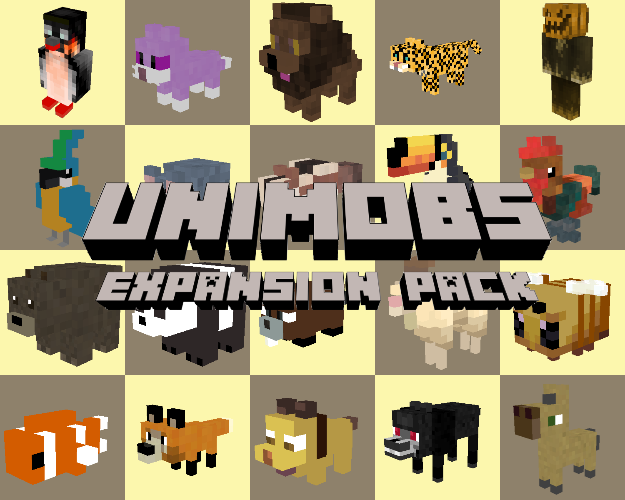

# Unified Mob Library (a unilib expansion pack)

## Latest release: v1.1.0 (1 Jun 2026) (see recent [changes](CHANGES.txt))

[unilib](https://github.com/axcore/unilib) is a mod for all Minetest-compatible engines, including [Luanti](https://www.luanti.org/).

[unimobs](https://github.com/axcore/unimobs) is an expansion pack for **unilib**, providing:

- Lots of animals, birds and insects
- A few monsters
- A new API based on [mobkit](https://github.com/mt-mods/mobkit) - see the API file for more details.

## Want to play? Download unigame [here](https://github.com/axcore/unigame)

- **unigame** is a traditional voxel game with many beautiful biomes and lots of stuff to collect
- It includes both **unilib** and **unimobs**
- No configuration is necessary - everything runs out of the box

## Want to tinker? Download unilib [here](https://github.com/axcore/unilib) and unimobs [here](https://github.com/axcore/unimobs).

- **unimobs** requires **unilib** (version v1.2.0 or later); it has no other dependencies
- No creatures are loaded automatically - it's up to you to choose what you want (see below)

## 1 Setting up unimobs

First, download the mod and its dependencies.

- Download [unimobs](https://github.com/axcore/unimobs), and add it to Minetest's **mods** folder
- Download [unilib](https://github.com/axcore/unilib) (v1.2.0 or later), and add it to Minetest's **mods** folder
- **unilib** content is modularised; you must choose what content you want to load
    - See the **List of included remixes** in the section below

Alternatively, download **unigame**, which requires no setup, because it already includes both **unilib** and **unimobs**.

- Download [unigame](https://github.com/axcore/unigame) (v1.2.0 or later), and add it to Minetest's **games** folder

### 1.1 Use the in-game system

This method requires **unilib** v1.2.0 (or later), or **unigame** v1.2.0 (or later).

- In **Minetest**'s main menu, create a new world (or choose an existing one)
- Click the **Select Mods** button, and enable both **unilib** and **unimobs**
- Now start the game
- New users will see a **Welcome to unilib** window
- Click **Browse all remixes** to open a new window
    - If the welcome window was not visible, type **/grantme unilib_admin**
    - Then type **/unilib**
- In the **List of remixes and packages**, add one or more of the remixes provided by **unimobs**
- For new users, one of the following pairs is recommended:

        mtgame petz
        gaia gaia_unimobs

- Click the **Save the list** button to apply the changes
- Restart the game

### 1.2 Creating custom remixes with the in-game system

This method requires **unilib** v1.2.0 (or later), or **unigame** v1.2.0 (or later).

You can easily create your own remix, and use it to specify which creatures you want in your game. You can also specify where they should spawn, what they should eat, and so on.

Start by setting up a new world.

- In **Minetest**'s main menu, create a new world (or choose an existing one)
- Click the **Select Mods** button, and enable both **unilib** and **unimobs**

Now start the game.

- New users will see a **Welcome to unilib** window
- Click **Create your own remix** to open a new window
    - If the welcome window was not visible, type **/grantme unilib_admin**
    - Then type **/unilib**
- In the new window, type a unique remix name, e.g. **myremix**
- Click the **Create new remix** button, and press ESCAPE to close the window

You can now edit the new remix.

- Type **/grantme unilib_admin**, if you haven't already
- Type **/edit_remix myremix**
- In the new window, open the **Mobs** tab
- Select a mob type from the drop-down box, e.g. **cat_normal**
- In the **Probability** box, add a number
    - e.g. 1 for mobs that spawn very frequently
    - e.g. 0.1 for mobs that spawn less frequently
- Click the **Add** button
- Now click the button with the yellow warning sign
- In the new window, click **Add the package and label automatically**
- The previous window has re-opend, so open the **Mobs** tab and click the **Save** button
- Press ESCAPE to close the window

Finally, add the new remix to the list of remixes that's loaded when the game starts.

- Type **/unilib**
- In the **List of remixes and packages**, add **myremix**
- Click the **Save the list** button
- Restart the game

If you prefer to do all of this using a text editor, rather than with the in-game system, then see the **Configuring unimobs for new biomes** section below.

### 1.3 Use Minetest settings

This method works with all versions of **unilib**, but is not available for users of **unigame**.

- In Minetest's main menu, create a new world (or choose an existing one)
- Click the **Select Mods** button, and enable both **unilib** and **unimobs**
- Now click the **Settings** button in the top right corner
- In the left panel, scroll down and select **Unified Voxel Library (unilib)**
- In the right panel, you should be able to see a box marked **List of remixes and packages to load**
- In the box, add one or more of the remixes provided by **unimobs**
- For new users, one of the following pairs is recommended:

        mtgame petz
        gaia gaia_unimobs

- Click the **Set** button to apply the changes
- When you're ready, start the game

### 1.4 Patch unilib code directly

This method works with all versions of **unilib** and **unigame**, but is only recommended if the methods above are not available.

- Open Minetest's data folder
- Navigate to **../mods/unilib/lib/system/global/**
- In a text editor, open the file **global_overrides.lua**
- Add the following lines:

        unilib.setting.enable_adult_content_flag = true
        unilib.setting.init_remix_pkg_set = "STUFF"

- Replace STUFF with one or more of the remixes provided by **unimobs**, e.g.

        unilib.setting.init_remix_pkg_set = "mtgame petz"
        unilib.setting.init_remix_pkg_set = "gaia gaia_unimobs"

- Save the file
- In Minetest's main menu, create a new world (or choose an existing one)
- Click the **Select Mods** button, and enable both **unilib** and **unimobs**
- When you're ready, start the game

# 2. Major new features

For more information about remixes, packages and CSV files, see the **Setting up unimobs** section below.

## 2.1 Custom spawning

Creatures will not spawn anywhere - for example, dolphins will not spawn on land, and sheep will not spawn on sand.

The **petz** and **gaia_unimobs** remixes each provide a CSV file which you can edit yourself (just use an ordinary text editor or a spreadsheet application). The file specifies where each creature will spawn.

## 2.2 Custom interaction

When creatures spawn in the world for the first time, they are untamed. Some wild animals (for example, lions) can be tamed using an obedience whip. Other creatures must be tamed by feeding them. A few types of creature can't be tamed at all.

Finding out how to tame each kind of creature is a part of the game! To get you started, you could try feeding some of the more common animals wheat, or maybe even a carrot or two.

Once a creature has been tamed, you can right-click it to see more information about it. This information includes the items needed to feed, breed or capture the creature, as well as the items used to make the creature follow you or back away. Unfortunately, that list of items is obscured at first (unless you've changed the default setting). Once again, you'll have to discover for yourself, through trial and error, which items to use!

You can edit the same CSV and choose a different selection of items for feeding, breeding and so on, if you want.

## 2.3 Genetics

In order to breed creatures, you must first find a male and a female (use a bestiary if you're not sure which is which).

Tame both parents, and then "feed" them both a particular item. (It's usually not the same item used for taming the creatures).

Having been fed, the creatures will start looking for a mate. You can save a bit of time by feeding the mother and father when they're already at the same location (alternatively, you can use a syringe - see below).

As in real life, most mothers have a limit on the number of babies they can produce, but that limit doesn't apply to fathers.

Almost all creatures have a set of genetic traits, inherited from their parents. If you want a pony that can run faster, or a cow that can produce more milk, then you can use *selective breeding* to improve their genetics (in each generation, breeding only the creatures with the best genetics, and discarding the rest).

Use a DNA Analyser to see a creature's genetics traits. This tool consumes mese crystals as fuel, but is at least very accurate. (The package code can be tweaked to produce a less accurate reading, and to use different fuels, if you want a longer challenge.)

If finding all that fuel sounds like too much work, then there's a workaround:

- Omit the **device_analyser_dna** package from your remix
- Right-click the creature to see its information
- Then click the genetics button near the bottom

Among the most common genetic traits are:

- Agility (improves a creature's speed; doesn't apply to mounted creatures)
- Compliance (reduces the number of lashes required to tame a wild animal)
- Digestion (reduces the amount of food needed to tame creatures other than wild animals)
- Docility (tamed mothers have a better chance of giving birth to tamed children)
- Fertility (reduces the length of pregnancies, reduces the time needed for a baby to grow into an adult, increases the maximum number of pregnancies for a mother)
- Incontinence (increases the amount of dung produced)
- Loftiness (increases the maximum flying height for birds)
- Luckiness (increases the chance of a baby getting a bonus improvement to one of its genetic traits; this is in addition to random increases/decreases applied to all babies)
- Perception (increases how far away the creature can spot other creatures and players)
- Productivity (increases the rate at which eggs are laid)
- Springiness (increases the creature's jump height)
- Toughness (increases the creature's maximum HP)
- Variability (increases the chance of a baby with a mutation; by default, it's 1 in 200)

Mounted creatures such as ponies and camels use the following traits, while being ridden by players:

- Forward speed when mounted
- Reverse speed when mounted
- Mounted speed boost (100% is added to the creature's velocity when galloping, 50% while riding forwards, 25% while riding backwards)

Some creatures have unusual genetic traits. For example, frogs have genes for *croakiness*, *liveliness* and *sliminess*. If you want to find out what each gene does, you'll have to do some breeding!

Creatures have a much greater range of skins than in the original **petz**. Ponies, for example, have up to 20 different skins. Skins are inherited from a creature's parents and grandparents. Some skins are rarer than others, and are more likely to be passed on to babies than other skins. There is also a small chance of a genetic mutation, which will give the creature a unique skin that doesn't occur naturally and can't be inherited.

# 3. Major old features

All tamed creatures can be given a name.

- Right-click the creature to see its information
- Type a name in the box at the top, then click the **Nametag not visible** button at the bottom
- See also the automatic name tagger, described below

Some tamed creatures can be given orders.

- Right-click the creature to see its information
- The green arrow buttons are used to give orders to the creature
- If no buttons are visible, then the creature doesn't obey orders
- Wild animals can be ordered to stand guard, attack other players that get too close
- Birds can be ordered to fly away, or land

*Tamagotchi Mode* is enabled by default (but can be disabled in settings). If enabled, you'll need to take special care of your tamed pets.

- Tamagotchi Mode does not apply to all types of pet - for example, it applies to dogs, cats and even lions, but not foxes or leopards
- After right-clicking the pet, you can see two stats - hunger and grooming
- A hungry pet can be fed using the same food you used to tame it
- If you don't feed the pet at least once in every two game days, it will start to get hungry
- An unfed pet will eventually starve to death
- Pets should also be groomed every two game days, using a hairbrush or beaver oil
- Wild animals like grizzly bears, lions and wolves can also be "groomed" with an obedience whip
- A neglected pet will eventually abandon you
- In multiplayer games, the pet's hunger and grooming is paused while its owner is offline
- If you need to leave your base, you can place a kennel or an animal cage
- Pets in a kennel or an animal cage don't need to be fed or groomed (but don't forget to close the door!)
- In Tamagotchi Mode, be careful not to punch your pet - as well as taking damage, it will become unhappy!

You can sell your pets to other players.

- Buying and selling is only available in multiplayer mode, when both buyer and seller are online
- Right-click your pet to see its information
- Give the pet a name, if it doesn't already have one
- Click the **Trade** button
- Pets can be exchanged for various valuable minerals (this can be adjusted in settings, if required)
- Select the price
- Other players can now see the pet's name, preceded by a dollar sign (indicating that it's for sale)
- Other players should right-click the pet, in order to buy it

Some features are disabled by default; you can re-enable them in settings.

- Creatures can have limited lifespans (but note that any creature equipped with a dreamcatcher is exempt)

There is also a new chat command.

- To remove all mobs within a 100 block range, type **/clear_mobs MOD**
- Replace **MOD** with the name of the parent mod, e.g. **unimobs**

# 4. List of mobs

## 4.1 Ants

### 4.1.1 Queen ants, warrior ants and worker ants

- Queen ants spawn naturally, and will fight each other to the death
- Queen ants build anthills near the coast or other bodies of water
- Warrior ants and worker ants spawn at anthills; the warriors will attack players
- Anthills are large subterranean structures that players will enjoy exploring
- After killing a number of queen ants, you'll be able to make a unique helmet

You can place an ant colony artificially, if you want to.

- Capture a queen ant
- Craft (or find) anthill bed blocks, and place them at the desired location
- Build walls of glass around the location, you can observe the colony
- Place the queen on the anthill bed blocks, and feed her wheat seeds
- The more you feed her, the more eggs will be produced
- Warriors and workers have a limited lifespan, so the colony will soon reach a stable population, regardless of how much you feed the queen

## 4.2 Bats

### 4.2.1 Normal bats

- Bats spawn shadowy places, not in direct sunlight
- Bats are attracted to fireflies

## 4.3 Bears

### 4.3.1 Grizzly bears

- Grizzly bears are wild animals, often found in forests, that attack players (and some other creatures)
- They can be tamed with an obedience whip
- Tamed grizzly bears can be ordered to stand guard, in which case they'll attack players that get too close
- Bears produce dung (scat)

### 4.3.2 Polar bears

- Polar bears are wild animals, often found in icy biomes, that attack players (and some other creatures)
- They can be tamed with an obedience whip
- Tamed polar bears cannot be given orders (unlike grizzly bears)
- Bears produce dung (scat)

## 4.4 Beavers

### 4.4.1 Normal beavers

- Beavers live near water, and occasionally build dams there
- Kill a beaver to obtain beaver oil and/or a beaver fur
- Beaver oil can be used in Tamagotchi Mode to keep some pets happy

## 4.5 Bees

### 4.5.1 Queen bees and Worker bees

- Queen bees spawn naturally, and can create a beehive near trees
- Worker bees do not spawn naturally, but instead live in their hives
- Worker bees collect pollen from nearby flowers, returning to the hive to convert the pollen to honey
- Worker bees stay close to their hive, and return there at night (but queen bees can fly at any time)
- If the hive is destroyed, the worker bees will soon die (unless you can catch them with a net)
- If the hive is destroyed, the queen bee will fly away, eventually founding a new hive
- Bees drop pollen and stingers when killed

This is how to farm honey from beehives:

- A beehive created by a queen contains 3 worker bees
- A hive you craft yourself initially contains no worker bees; a single bee will be "born" several minutes after the hive is placed in the world
- You can right-click a hive with captured worker bees, to increase its population up to the limit of 3
- Each hive can contain a maximum of 10 honey
- Bees won't search for honey when the hive is already full (but they will still leave the hive and fly around during the day)
- Extract honey from a hive by right-clicking it with an empty bottle
- Place an igniter or a torch under the hive to force out its bees
- Destroying a hive will kill the bees, but will also drop honeycomb
- Honeycomb can be used to craft beeswax, which can be used to craft candles
- Honey blocks are decorative items, and also an inefficient way to store honeycomb (since the honey used to craft it is not returned)

## 4.6 Butterflies

### 4.6.1 Large butterflies

- Butterflies only spawn in bright areas; open plains are the best place to find them
- Butterflies captured with a bug net can be used to craft a Butterfly Showcase
- The butterflies in a showcase are DEAD, and cannot be removed!
- Butterflies can also be captured with an empty glass bottle
- Break the bottle to release the butterfly, still alive

## 4.7 Camels

### 4.7.1 Normal camels

- Camels - found in hot, dry places - are an alternative to ponies
- After placing a saddle on a tamed camel, it can be ridden by players
- Right-click the camel to place the saddle, then right-click again to mount or dismount the camel
- Baby camels cannot be riden
- After being equipped with saddle-bags, tamed camels can be used to transport items
- Right-click the camel to place the saddle-bag, right-click (or SHIFT-right-click) the camel to see its information, then click the saddle-bag icon to open the camel's inventory
- Saddles and saddle-bags can be removed with shears
- Naturally-occuring camels are slow; use selective breeding to improve their genetics
- Camels ride a little faster (or a little slower) on certain surfaces; see the "racing turfs" section below
- Hold down the SNEAK key to gallop (ride a little faster); this only lasts until the camel is exhausted
- Camels can be milked using an empty bucket; the milk can be cooked to make yoghurts
- The milk is replenished after the camel has eaten some turf, or after being fed by a player

## 4.8 Cats

### 4.8.1 Normal cats

- Cats like to sleep during the day
- If you place your cat in a basket, it will sleep the whole day and night (useful for keeping you cat safe while you're away)
- A sleeping cat in a basket can be awoken by destroying the basket (or restarting the game)
- Right-click the basket to change its orientation
- Cats have an unusually large number of skins

## 4.9 Chickens

### 4.9.1 Roosters, Hens and Chicklets

- Hens produce eggs from time to time, if there is an empty nest nearby, and without being fed by players
- You can breed chicklets by crafting empty nests, then waiting for the eggs to hatch
- To remove an egg from its nest, right-click it
- Chicken eggs can be used as ingredients in various food items
- Chickens cannot fly
- Use shears on a chicken to obtain a feather
- Chickens provide a code example of a mob that has distinct forms (different entities) for male and female adults, and babies (see elephants for a comparable example)

## 4.10 Chimpanzees

### 4.10.1 Normal chimpanzees

- Chimpanzees can climb trees (up to a certain height)

## 4.11 Cows

### 4.11.1 Normal cows

- Use an empty bucket on a cow to get some milk
- The milk is replenished after the cow has eaten some turf, or after being fed by a player
- Milk can be used as an ingredient in various food items, or can be drunk
- Kill the cow to get leather
- Their meat is edible, when cooked
- Cows produce dung

## 4.12 Deer

### 4.12.1 Simple deer

- This simplistic creature from the [wildlife mod](https://github.com/TheTermos/wildlife) was written as a demonstration of **mobkit**'s abilities
- It cannot be tamed or bred, and it does not have a spawn egg
- It flees from simple wolves

## 4.13 Dogs

### 4.13.1 Normal dogs

- By default, dogs do not occur in nature
- By default, you can convert a normal wolf into a dog by feeding it bones
- Dogs like to play "fetch" with square balls
- Left-click while wielding the ball to throw it
- If it lands near a tamed dog, the dog will bring the ball back to you

## 4.14 Dolpins

### 4.14.1 Bottlenose dolphins

- Dolphins live in the ocean
- When killed, they drop a variety of fishes

## 4.15 Ducks

### 4.15.1 Normal ducks

- Female ducks produce eggs from time to time, if there is an empty nest nearby, and without being fed by players
- You can breed ducks by crafting empty nests, then waiting for the eggs to hatch
- To remove an egg from its nest, right-click it
- Duck eggs can be used as ingredients in various food items
- Ducks cannot fly
- Use shears on a duck to obtain a feather
- Their meat is edible, when cooked

## 4.16 Elephants

### 4.16.1 Normal elephants

- Don't kill the elephants for their tusks, you monster!
- Elephants provide a code example of a mob that has distinct forms (different entities) for male and female adults (see chickens for a comparable example)

## 4.17 Fish

### 4.17.1 Clownfish and Tropical Fish

- Fish are fascinated by some types of coral
- Fish can be captured and placed in a fish tank
- Use an animal net to retrieve a fish from its tank
- In Tamagotchi Mode, you don't need to take care of a tamed fish placed in a tank
- Fish have genetic traits, just like most creatures. A fish doesn't lose its genetics when placed in a tank
- Like all aquatic creatures, fish cannot survive without water

## 4.18 Flamingoes

### 4.18.1 Normal flamingoes

- Use shears on a flamingo to obtain a feather
- Flamingoes without feathers cannot fly
- While wielding the feather, right-click the flamingo to restore its flying abilities

## 4.19 Foxes

### 4.19.1 Normal foxes

- By default, foxes will hunt chickens, ducks and other small animals
- So make sure vulnerable pets are safe inside some kind of enclosure!

## 4.20 Frogs

### 4.20.1 Normal frogs

- Kill a frog to get a frog leg
- Frog legs can be cooked to make a simple meal

## 4.21 Geckos

### 4.21.1 Normal geckos

- Female geckos can lay eggs, but they don't require an empty nest (and don't need to be fed by players)
- Geckos lay eggs only once in their life (by default)
- This happens automatically, without being fed by players

## 4.22 Goats

### 4.22.1 Normal goats

- Use an empty bucket on a goat to get some milk
- The milk is replenished after the goat has eaten some turf, or after being fed by a player
- Their meat is edible, when cooked
- Goats produce dung
- Goats will form herds with other goats
- Goats will follow their owner if wielding a shepherd's crook

## 4.23 Hamsters

### 4.23.1 Normal hamsters

- Hamsters are so cute and adorable - especially ones with rare colours!
- They can often be found in hot and arid regions

## 4.24 Leopards

### 4.24.1 Normal leopards and snow leopards

- Leopards are aggressive, so try to keep your distance
- When killed, they drop valuable skins

## 4.25 Lions

### 4.25.1 Normal lions

- Lions are wild animals that attack players (and some other creatures)
- By default, lions eat raw meat, and can be tamed with an obedience whip
- Tamed lions can be ordered to stand guard, in which case they'll attack players that get too close

## 4.26 Monsters

### 4.26.1 Evil Santa

- Evil Santa is a seasonal monster; by default, he appears only during the (real) month of December (and even then, only in darkness)
- Evil Santa is tough, but if you manage to kill him, expect to be rewarded with presents!

### 4.26.2 Mr Pumpkin

- Mr Pumpkin is a seasonal monster; by default, he appears only during the (real) month of October (and even then, only in darkness)
- He will attack players on sight, throwing lantern grenades at his enemy
- The grenades can set fire to flammable materials
- Mr Pumpkin's special ability is teleportation - when fighting him, be careful that he doesn't re-appear behind you!

### 4.26.3 Werewolves

- Werewolves are dangerous monsters that will attack players on sight
- Werewolves spawn only in dark and shadowy places
- When attacked, players risk being afflicted by the Curse of Lycanthropy
- Infected players enjoy special abilities and chat commands, but can only eat raw meat
- Infected players appear to be normal after the first sunrise - until night comes again!
- Infected players can wear armour, and won't be attacked by other wild animals
- The curse can be lifted by crafting, then drinking, a lycanthropy remedy
- Werewolves - as well as infected players - belong to one of four clans
- You can disable the Curse of Lycanthropy by making sure that the **shared_petz_lycanthropy** package is not loaded

## 4.27 Moths

### 4.27.1 Normal moths

- Moths spawn in dark and shadowy places, and will die in direct sunlight
- Moths can be captured with an empty glass bottle
- Break the bottle to release the moth
- Female moths lay eggs without being fed by players
- When the eggs hatch, silkworms are produced

## 4.28 Pandas

### 4.28.1 Normal pandas

- Unlike in real life, pandas can be tamed, usually with some kind of bamboo

## 4.29 Parrots

### 4.29.1Normal parrots

- Tamed parrots respond well to orders
- You can order a parrot to sit on your shoulder for a couple of minutes
- After catching a parrot with an animal net, you can place it on a bird stand
- Right-click the stand to change its orientation
- A parrot on a stand can be ordered to fly away
- Use shears on a parrot to obtain a feather
- Parrots missing a feather are unable to fly
- While wielding the feather, right-click the parrot to restore its flying abilities
- Parrot meat is edible (but is much more tasty after being cooked)

## 4.30 Penguins

### 4.30.1 Normal penguins

- Penguins can lay eggs, but they don't require an empty nest (and don't need to be fed by players)
- Penguins eggs can be used as ingredients in various food items (but players are not the only creatures interested in penguin eggs)
- Penguins cannot fly
- Use shears on a penguin to obtain a feather
- Penguins produce dung (guano)

## 4.31 Pigeons

### 4.31.1 Normal pigeons

- Use shears on a pigeon to obtain a feather
- Pigeons without feathers cannot fly
- While wielding the feather, right-click the pigeon to restore its flying abilities

## 4.32 Pigs

### 4.32.1 Normal pigs

- Pigs are only useful for producing pork chops, which are dropped when you kill them
- Pork chops taste much better when cooked
- Pigs produce dung

## 4.33 Ponies

### 4.33.1 Normal ponies

- After placing a saddle on a tamed pony, it can be ridden by players
- Right-click the pony to place the saddle, then right-click again to mount or dismount the pony
- You can also ride behind the pony in a wagon
- Right-click the pony to attach the wagon, then right-click again to mount or dismount it
- Saddles and wagons can be removed with shears
- Baby ponies cannot be riden and cannot be attached to wagons
- Naturally-occuring ponies are slow; use selective breeding to improve their genetics
- Ponies with horseshoes ride faster; the more horseshoes, the better
- Right-click the pony to equip it with up to 4 horseshoes
- Horseshoes can be removed by right-clicking (or SHIFT-right-clicking) the pony to see its information, then clicking the horsehoe button
- Ponies ride a little faster (or a little slower) on certain surfaces; see the "racing turfs" section below
- Hold down the SNEAK key to gallop (ride a little faster); this only lasts until the pony is exhausted
- Ponies have an unusually large number of skins
- Ponies stay close to straw bales, and eat them if they're hungry

## 4.34 Rabbits

### 4.34.1 Normal rabbits

- When killed, rabbits drop rabbit hides
- Their meat is edible when cooked

## 4.35 Rats

### 4.35.1 Normal rats

- Rats are disagreeable creatures that will attack players on sight
- However, they only spawn in dark and shadowy places

## 4.36 Sheep

### 4.36.1 Normal sheep

- Use shears on a sheep - or, just kill it - to get some wool
- The wool regrows after the sheep has eaten some turf, or after being fed by a player
- Use dye on a sheep to colourise it
- Shear the sheep to get some colourised wool; when the wool regrows, it has its natural colour
- Sheep with dyed wool don't pass on the colour to their babies
- Some sheep mutations produce strawberry and vanilla wool when sheared
- Sheep produce dung
- Sheep will form herds with other sheep
- Sheep will follow their owner if wielding a shepherd's crook
- Their meat is edible, when cooked

## 4.37 Silkworms

### 4.37.1 Normal silkworms

- Silkworms eat leaves
- From time to time, silkworms will form a cocoon (chrysalis), later re-emerging as a moth
- The cocoons can be used to craft silk, which can in turn be used to craft fine garments

To get a lot of silk, start a silk farm.

- Build a room with a bed of leaves, and fill it with silkworms and/or moths
- The moths will lay eggs, and the resulting silkworms will turn into cocoons
- Silk garments - an elegant type of armour - are crafted using silk bobbins
- Silk bobbins can be crafted by hand, but it's much quicker to use a spinning wheel
- Right-click the wheel with up to 3 cocoons to generate a bobbin

## 4.38 Squirrels

### 4.38.1 Normal squirrels

- Squirrels can climb trees (up to a certain height)
- Squirrels sometimes drop acorns (if they exist in your world)

## 4.39 Tarantulas

### 4.39.1 Normal tarantulas

- Tarantulas are dangerous monsters that will attack players on sight
- Tarantulas use cobwebs on their enemies
- Tarantulas drop spider eyes when killed; the eyes are currently not used for anything
- Tarantulas spawn only in dark and shadowy places

## 4.40 Toucans

### 4.40.1 Normal toucans

- Toucans are typically found in forests
- Tamed toucans respond well to orders
- You can order a toucan to sit on your shoulder for a couple of minutes
- After catching a toucan with an animal net, you can place it on a bird stand
- Right-click the stand to change its orientation
- A toucan on a stand can be ordered to fly away
- Use shears on a toucan to obtain a feather
- Toucans missing a feather are unable to fly
- While wielding the feather, right-click the toucan to restore its flying abilities

## 4.41 Turtles

### 4.41.1 Normal turtles

- Turtles are semiaquatic animals that tend to eat aquatic plants like kelp and seagrass
- When killed, they sometimes drop their shells

## 4.42 Wolves

### 4.42.1 Normal wolves

- Wolves will back away from players, but they become aggressive when attacked
- There is a small chance that a wolf can infect players with the Curse of Lycanthrophy (see werewolves for more information)
- Wolves can be tamed with an obedience whip
- Tamed wolves can be ordered to stand guard, in which case they'll attack players that get too close
- A tamed wolf can be converted into a dog, usually using bones

### 4.42.2 Simple wolves

- This simplistic creature from the [wildlife mod](https://github.com/TheTermos/wildlife) was written as a demonstration of **mobkit**'s abilities
- It cannot be tamed or bred, and it does not have a spawn egg
- It hunts simple deer

# 5. List of items

This list doesn't include items that have already been described above.

## 5.1 Admin tools

Admin tools have no craft recipes, so are not available to ordinary players.

- The mob accelerator converts a baby creature into an adult
- The mob breeder makes a female creature pregnant, if possible
- The mob commander empties the mob's behaviour queues, then inserts a new behaviour into them
- The mob interruptor cancels a pregnancy, or stops creatures from looking for a mate
- The mob investigator shows the creature's current behaviour queues
- The mob soother calms an aggressive creature (temporarily)
- The mob spawner can be used to spawn a creature of your choice, in a skin of your choice (compare spawn eggs, which create a creature with a random skin)
- The mob stimulator makes creatures search for a mate (if possible)
- The mob tamer tames an unowned creature (if possible)
- The cobweb gun can be used to test cobwebs, usually produced by tarantulas
- The lantern gun can be used to test lantern grenades, usually produced by Mr Pumpkin

## 5.2 Animal bones

- Bones are often dropped when you kill a creature
- They can be used to craft different types of fertiliser

## 5.3 Animal cages and kennels

- After crafting a cage or a kennel, left-click to place it in the world
- Cages and kennels are useful in Tamagotchi Mode (see above)

## 5.4 Bestiaries

- A bestiary is a book that helps you to identify different creatures
- The bestiary works on most creatures, not just those you've tamed
- To find out basic information about a creature, right-click it while wielding the bestiary
- Be careful, though, not to get too close to aggressive creatures!

## 5.5 Christmas presents

- Christmas presents are dropped by Evil Santa (and can also be crafted)
- You can surprise your friends by placing a present at their front door
- Don't forget to write a nice message, and to fill the present with lots of goodies!

## 5.6 Dreamcatchers

Dreamcatchers can be used in three ways.

- Dreamcatchers prevent other players from injuring your pets
- While wielding the dreamcatcher, right-click a tamed creature
- To remove the dreamcatcher, right-click the tamed creature to see its information, then click the dreamcatcher button
- Dreamcatchers won't protect your pets from **you**!
- If you kill a tamed creature, it will drop its dreamcatcher

Dreamcatchers can also be used to stop your pets from wandering off too far.

- Equip the pet with a dreamcatcher, as described above
- Right-click the pet to see its information
- Click the **Set creature home** button
- Now click the **Automatic go home** button to enable it
- The pet will teleport back to this location from time to time
- Don't forget that after releasing a captured pet far from home, it will teleport back almost immediately

Dreamcatchers can also be used to keep track of your pets.

- Left click while wielding the dreamcatcher
- You'll see a list of pets that have been named and equipped with a dreamcatcher
- You can use a whistle to summon those pets

**Warning**: dreamcatchers will not prevent the engine from deleting faraway pets, after a game restart.

## 5.7 Dung

- Some creatures produce dung (including scat and guano)
- If left alone, dung will disappear after a few minutes
- Alternatively, you can use it for creating building materials
- Dung can also be used to craft different types of fertiliser

## 5.8 Name taggers

- The automatic name tagger is a labour-saving device
- When used on a creature, it assigns a generic nametag like "Cat 32"
- This might be useful during large breeding programmes, when you want a rapid way to distinguish one group of creatures from another
- The generic nametag can be changed to a unique one in the normal way
- A nametag - generic or unique - can also be removed using the tagger

## 5.9 Parchment

- Parchment is an alternative to paper, when crafting books

## 5.10 Pet bowls

- Pets will stay near a pet bowl, so place one in any house you build for your pets
- In Tamagotchi Mode, a pet bowl feeds pets

## 5.11 Racing turfs

- In the original [petz modpack](https://github.com/yl-whosit/petz/), pony and camel races were not much fun, as those animals often had identical speeds
- Racing turfs look superficially like ordinary dirt-with-turf nodes, but slightly increase (or decrease) the speed of the mounted animal passing over it
- You can make a fun race course by placing these nodes at random locations
- Races will then be won by the most observant (or the luckiest!) player
- Any node can be used to increase or decrease the speed of the pony/camel
- For the default list, see the file **../csv/remixes/petz/racing_nodes.csv**

## 5.12 Sketchbooks

Sketchbooks are a game within a game.

- While wielding the sketchbook, right-click any creatures you discover
- A "sketch" of the creature appears in the book
- To complete the "game", try to sketch every type of creature, with every type of skin
- Right-click while wielding the sketchbook, to see how many creatures and skins you've sketched
- When you fill the sketchbook, you'll get a little ribbon as a reward
- Be careful, though, not to get too close to aggressive creatures!

There are two types of sketchbook aimed at beginner and advanced artists.

- The advanced book includes rare mutations
- Creatures with mutations don't spawn naturally; they are the results of extensive breeding programmes
- Therefore, filling the advanced sketchbook will take a very, **very** long time
- You can fill the beginner's sketchbook without first breeding a bunch of mutations
- Some creatures and skins are difficult to find, so even this activity will take quite a long time

New sketchbooks are empty, by default. If you want, you can modify settings in order to auto-fill them; this might be useful for authors who are writing new mobs, or tweaking the existing ones.

## 5.13 Syringes

- If two creatures are not at the same location, you can use a syringe for breeding
- While wielding the syringe, get a DNA sample by right-clicking the father
- Then right-click the mother to impregnate it
- In the original [petz modpack](https://github.com/yl-whosit/petz/), syringes could be used only with ponies and camels
- In **unimobs**, syringes can be used with most creatures
- You can impregnate a creature that belongs to another player, but the babies will still belong to that player

## 5.14 Whistles

- Whistles are used to summon your pets, no matter how far away they are
- Right click while wielding the whistle
- You'll see a list of your pets and their current locations
- Click on one of the listed pets to summon it
- Whistles only work on pets that you've named

# 6. List of included remixes

For more information about remixes, packages and CSV files, see the **Setting up unimobs** section above.

## 6.1 mobkit

**unimobs** is based on the [mobkit](https://github.com/mt-mods/mobkit) mod.

**mobkit** does not itself provide any mobs; instead, it provides a set of tools for anyone who wants to write their own mobs. Those tools are used to specify each creature's behaviour - roaming around the world, fleeing from predators, and so on.

**mobkit** provides a number of standard behaviours, ready for use. These behaviours have been imported as **unilib** packages, all of which are included in this remix.

Because **unilib** packages always know about their dependencies - including the behaviours they need - it's not actually necessary to specify this remix.

## 6.2 mobkit_essential

A small number of behaviour packages are deemed *essential*, because **unimob**'s system code might want to apply them to any creature. This remix contains just the *essential* packages.

The remixes below load **mobkit_essential** automatically, so in most cases, it's not necessary to specify this remix.

## 6.3 petz

The [petz modpack](https://github.com/yl-whosit/petz/) provides about 50 new creatures as well as many new behaviours and items. It is not being maintained any more.

Nearly everything in **petz** has been imported into **unimobs**. The imported code has been extensively re-written, introducing countless improvements for both players and creators. Numerous bug fixes have also been applied.

## 6.4 petz_mini

This remix contains all of the logic and behaviour packages from the **petz** remix, but nothing else, including none of the creatures.

## 6.5 gaia_unimobs

This remix is based on the **petz** remix, but has been re-configured to use the biomes, nodes and items provided by the **gaia** remix.

## 6.6 wildlife

The [wildlife mod](https://github.com/TheTermos/wildlife) was written as a demonstration of **mobkit**'s abilities. It provides just two simple creatures: a deer, and a wolf that hunts it.

These creatures have none of the features imported from **petz** (they can't be tamed or bred); they serve mostly as code examples for authors who want to write new creatures without those features.

# 6.7 awards_unimobs

This remix provides awards for unimobs-based creatures and items. Awards must be enabled in settings.

# 7. Configuring unimobs for new biomes

Not all creatures spawn in all biomes. A file called **mob_settings.csv** tells **unimobs** where to spawn each creature. The file can be found in the remix folders:

- If you're playing [minetest_game](https://github.com/minetest/minetest_game), then the correct file is **../remixes/petz/mob_settings.csv**
- If you're playing **unigame**, then the correct file is **../remixes/gaia_unimobs/mob_settings.csv**

These remixes will only spawn creatures in biomes created by [minetest_game](https://github.com/minetest/minetest_game) or **unigame**. If your world contains a different set of biomes, then you'll have to edit the file (or write a new one). This section explains how to do that.

## 7.1 Editing the file

**mob_settings.csv** can be opened in any spreadsheet application; just make sure that the correct column separator has been selected: it should be the pipe character **|**, not a comma.

If you create new files, or if you modify existing ones, you should **always create a backup copy of your changes**.

## 7.2 Creating a new remix

You can of course edit the existing **mob_settings.csv** files, but in general it's better to create your own remix.

The [documentation here](https://github.com/axcore/unilib) describes the process in detail; here's a quick summary.

- For example, let's create a remix called **mymobs**
- Create a new folder, **../csv/remixes/mymobs**
- Inside that folder, create a new file, **packages.csv**. This file will remain empty
- From the **../csv/remixes/petz** folder, copy the files **mob_settings.csv** and **constants.csv** into your new folder, **../csv/remixes/mymobs**
- Add the **mymobs** remix to your game's list of remixes, as described above

## 7.3 Understanding mob_settings.csv

Open **mob_settings.csv** in a suitable editor, such as a spreadsheet application.

Near the top, you'll notice some explanatory notes. You can ignore them for now.

Below that, you'll find a list of mobs. Internally, mobs have names like **cat_normal** and **bee_queen**. These names can't be changed (unless you want to change the **unimobs** code itself).

Every line that begins with a **#** character is ignored. You can prevent certain mobs from spawning by inserting that character at the start of a line, for example by changing **cat_normal** to **#cat_normal**. (Any cats already in the world will still exist, but no new ones will spawn.)

The second column often contains **CAN_SPAWN**, **CANNOT_SPAWN** and **DISABLE_SPAWN**. The latter two will also prevent a creature from spawning in the world.

If you like, you can change **CAN_SPAWN** to **CANNOT_SPAWN**, and vice-versa. For example, dogs do not spawn by default, because there's a mechanism for converting wolves into dogs by feeding them bones (more on that later). However, if you actually want a world of naturally-spawning dogs, you can change **CANNOT_SPAWN** to **CAN_SPAWN**.

However, **DISABLE_SPAWN** should not be changed. It applies to creatures which spawn in the world because of some special mechanism: worker ants are generated by anthills, chicklets hatch from eggs, and so on.

Note that **CAN_SPAWN**, **CANNOT_SPAWN** and **DISABLE_SPAWN** must always be in CAPITAL LETTERS, or they won't be recognised.

## 7.4 Understanding constants.csv

Now open **constants.csv** in a suitable editor.

This file converts values that are easy for a human to read, such as **CAN_SPAWN**, into the values used by **unimobs** internally. You can remove them if you don't need them, but don't modify them.

This same file also adds a number of *shortcuts*. For example, when editing **mob_settings.csv**, it's much easier to write **PUMPKIN** instead of the full node name for a pumpkin, which is **unilib:produce_pumpkin_yellow_grow_8**.

Shortcuts can be converted into a single node, or several nodes; just make a list of the node names, separated by spaces. Group names are also supported.

        STONE|unilib:stone_ordinary unilib:stone_desert group:cobble

Shortcuts are case-sensitive. If you want to add new shortcuts, then you should write them in CAPITAL LETTERS. (This is a convention, not a rule; it makes the **mob_settings.csv** file much easier to read.)

## 7.5 Configuring spawning

You can now edit **mob_settings.csv** to specify where each mob can spawn. Here's a summary for each column.

- **custom_spawn_probability** - a number in the range 0-1, where 1 means that the creature spawns often, and 0.1 would mean that it spawns rarely.

In **unimobs**, spawning works like this: every 30 seconds (by default) a location is chosen, then a list of all the creatures that can spawn at that location is compiled. One is chosen at random. If its spawn probability is 1, it will spawn; if the probability is 0.5, a mob will spawn half the time, and nothing will spawn the rest of the time.

Note that use of **NO_CUSTOM_SPAWN**. This is a *column filler* - a shortcut that is ignored by the **unimobs** code; it's there to tell you what sort of values should be added to this column.

**NO_NODE** and **NO_BIOME** are also column fillers (see the **constants.csv** file for a complete list of them). If you were to remove all of the column fillers from **mob_settings.csv**, nothing would happen.

- **spawn_node_str** - a list of one or more nodes on which the mob can spawn. **NO_NODE** means that the mob can spawn on any node (as long as other restrictions don't apply).

As mentioned above, you can specify both shortcuts like **DIRT_WITH_TURF** and actual node names like **unilib:sand_ordinary**. Node groups like **group:sand** can also be specified.

- **spawn_biome_str** - a list of one or more biomes in which the creature can spawn. **NO_BIOME** means that the creature can spawn in any biome.

- **spawn_max_height** - the maximum height at which the creature can spawn; a number like 100. **NO_MAX_HEIGHT** means that no maximum height applies to this creature.

- **spawn_min_height** - the minimum height at which the creature can spawn; a number like 1 (which in **Minetest** is the sea level). **NO_MIN_HEIGHT** means that no maximum height applies to this creature.

## 7.6 Configuring other columns

The remaining columns modify the creature's behaviour in some way. You can edit them, if you want to.

- **spawn_herd_size** - some creatures, like wolves and sheep, spawn in groups or "herds". **NO_HERD** means that the creature never spawns in a herd; otherwise, you can specify the maximum size of a herd. (Each individual herd will have a random size, up to this maximum value.)

- **predator_list** and **prey_list** - some creatures hunt other creatures. For the sake of realism, predators might only hunt one or two types of prey. If you want to enable frogs to hunt grizzly bears, don't forget to add an entry to both columns. **NO_PREDATOR** and **NO_PREY** are the column fillers for everything else.

- **repel_item_str** - a list of one or more items (or item groups). When the player wields the item, the creature moves away (for example, lions fear torches). By default, most creatures aren't afraid of any item, in which case **NO_REPEL** is used.

- **follow_item_str** - a list of one or more items (or item groups). When the player wields the item, the creature moves closer, and will follow a moving player. By default, most creatures will follow at least one item, otherwise **NO_FOLLOW** can be used.

- **feed_item_str** - a list of one or more items (or item groups), which can be used to feed the creature. Many creatures will become tame after being fed a few times. The item used for feeding is often the same one used for making a creature follow you. **NO_FEED** is commonly used for creatures that can't be fed or tamed.

- **custom_tame_count** - by default, a creature will be tamed after being fed 5 times, though it might be fewer for creatures with good genetics. You can specify a different number of feedings (e.g. 10) here, if you want to; otherwise we use **NO_CUSTOM_TAME**.

- **breed_item_str** - a list of one or more items (or item groups), which can be given to creatures in order to produce babies. As described above, you will need to find both a mother and a father, and the item must be used on both of them.

**DISABLE_BREED** is used for creatures that cannot be bred (at all). **CANNOT_BREED** is used for creatures that can't be bred at the moment (unless using a syringe); you are free to swap **CANNOT_BREED** for any items you like.

- **max_mating_distance** - after being fed the breeding item, the mother won't fall pregnant until she is actually next to the father (in which case we use the **NO_DISTANCE** shortcut). For some mobs, a slightly larger separation can be specified. Modifying this column is not recommended, in general.

- **convert_with_str** - by default, wolves are converted to dogs after being fed a few bones. This column is a list of one or more items (or item groups) used to convert a creature from one type to another.

The **convert_to** column specifies the result of the conversion (the creature becomes a dog, in this example). The **custom_convert_count** column specifies how many items are required for a conversion (5, in this example).

By default, only wolves can be converted; the column fillers **NO_CONVERT_WITH**, **NO_CONVERT_TO** and **NO_CUSTOM_CONVERT** are used with everything else.

- **harmful_node_str** - a list of one or more nodes which injure some nearby creatures. This doesn't apply to any **unimobs** creature, by default, but you could easily swap the column filler **NO_HARMFUL** for a node name like **unilib:sand_ordinary**, or something like that.

Note that, regardless of any changes you make to this colum, fish will still die on land, dogs will still drown under water (although they know how to swim), and just about anything will die if it falls into a pool of lava.

- **custom_str** - a few creatures have unique properties that can be modified in **mob_settings.csv**. For instance, beavers can build dams, but you can change that behaviour by replacing **can_create_beaver_dam=true** with **can_create_beaver_dam=false**. If you replace it with the column filler **NO_EXTRA**, then the beaver's default behaviour will apply - which is to build dams.

*All* of the values in this column are actually the default values, so there's no need to make any changes unless you actually want to change default behaviour.

Two of the monsters are worth mentioning. By default, Evil Santa only spawns in the real-life month of December (**spawn_month=12**), whereas Mr Pumpkin only spawns in October (**spawn_month=10**). To make them spawn throughout the year, replace these values with the column filler **NO_EXTRA**.

- **check** - this column is ignored; it's there for the benefit of anyone who wants to modify the file using a text editor, rather than a spreadsheet. Code in the **meta_petz_settings** package can be tweaked to display the contents of this column, in order to check that you haven't deleted or added a column by mistake.

# 8. Settings

**unimobs** is highly configurable. We've already talked about choosing the remixes and packages you want to load, and about modifying the CSV files to change the behaviour of various creatures.

But there are also a large number of **Minetest** settings that can be configured according to your tastes.

- In **Minetest**'s main menu, click the **Settings** button in the top right corner
- In the left panel, scroll down and select **Unified Mob Library (unilib expansion pack)**
- In the right panel, change any settings you like
